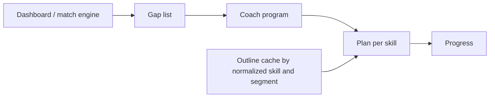
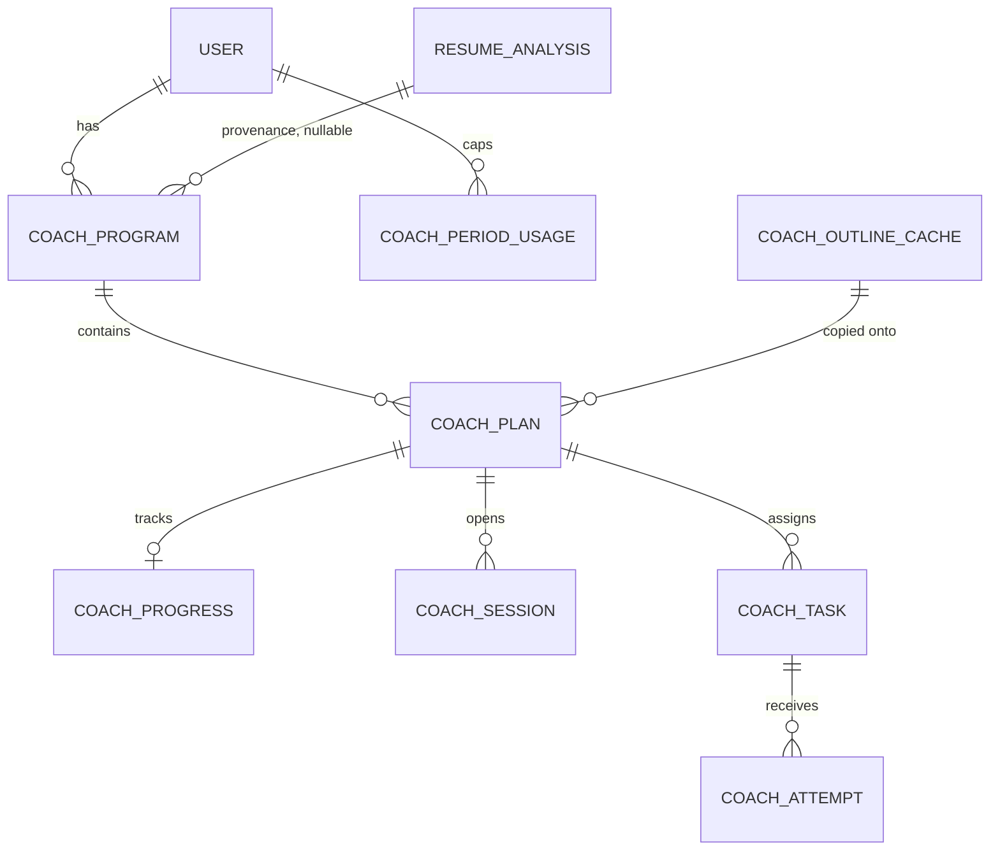

# Skill Coach

Status: design approved. Assumptions A–F checked against `docs/career-profile.md` at `d691aea` on `cursor/career-profile-41f4`. This change is the doc update only.
Owner: Skill Coach.
Reviewer: engineering head.
Depends on: that career-profile branch merging. It is not on this branch.

**Do not start phase 1 code until `cursor/career-profile-41f4` is merged.** The first Coach migration is `0018`. `0015` is the resume builder (`resume_version` template columns), `0016` is the career profile, and `0017` is the resume share-password drop. Do not take those numbers.

Skill Coach is the retention and paid loop for Zaprill's career-intelligence pivot. For each technical skill gap between a user's career profile and a technical target role, it gives a learning plan, an AI tutor, graded practice, progress, and a mock interview. The free tier keeps the full plan and a small taste of the tutor, one graded test a week, and one mock a month. Every paid plan includes the same coaching, with higher limits. Mock interviews are part of the subscription, not a separate purchase.

This document does not define a profile schema and does not change `user`, `user_profile`, `resume`, or `resume_analysis`. Skills are referenced by the profile contract.

## 1. What exists today

Gap analysis is a single request, not a learning product.

| Piece | Where | What it actually does |
| --- | --- | --- |
| Gap math | `aggregateSkillGaps` in `src/lib/match-engine.ts` | Counts missing skills across matched jobs. Priority is frequency: high above 50% of jobs, medium above 25%, else low. The career profile at `d691aea` does not compute gaps. This engine is still the only gap producer. |
| Roadmap generation | `POST /api/analyze-gaps` | `generateText` with `openai("gpt-5-mini")`. The model filters naive gaps and returns `advice`, `relevantSkillGaps`, and `roadmap` as JSON. Zod validates the shape. A 7-day cache reuses `resume_analysis` when `resume_skills` and `inferred_job_titles` match, and logs a zero-token `analyze_gaps` row. |
| Persistence | `resume_analysis.skill_gaps`, `.roadmap`, `.advice` | JSON blobs on the analysis run. Nothing is a plan the user can resume tomorrow. |
| UI | `LearningRoadmap` on the Analyze "Learning Roadmap" tab | Renders priority, why, time, and resources. Expand and outbound clicks go to analytics only. No completion state. |
| Catalog | `learning_resources`, `resource_clicks`, `GET /api/r` | Curated rows keyed by a normalized skill string. `enhanceRoadmapResource` prefers an active catalog row and rewrites the link through `/api/r`. Otherwise a non-http URL becomes a Google search link. |
| Usage log | `ai_usage_log`, `logAiUsage` in `src/services/ai/usage.service.ts` | Append-only, fire-and-forget. `MODEL_RATES` prices `gpt-5-mini` at $0.25 / 1M input and $2.00 / 1M output. The logger bills `inputTokens` and `outputTokens` only. It does not record reasoning tokens. |
| Agent pattern | `src/lib/agents/resume-architect.ts` and `POST /api/resumes/[id]/ai/chat` | `ToolLoopAgent`, `gpt-5-mini`, `reasoning: "low"`, `stopWhen: isStepCount(12)`, streamed with `createAgentUIStreamResponse`. One `onEnd` usage callback logs the loop as a single `resume_chat` row. No per-user turn cap. |
| Billing gate | `getSubscriptionWithAccess` | Binary. Any granting subscription is "pro". `plan.category` is `free`, `pro`, or `max`, and nothing in the coach path reads it. |
| Plan copy | `plan.features` and `src/scripts/seed-plans.ts` | Marketing bullets and INR prices (Cashfree, GST 18% on paid plans). Copy today mentions a weekly skill test and AI coaching. Those sentences are not entitlements. Prices will change. Coach limits do not read them. |
| Settings switch | `app_settings`, `referral_enabled` in `src/lib/app-settings.ts` | Admin key-value flags. Coach kill switch follows this pattern. |
| Profile today | `user_profile` | Onboarding status, primary resume, raw resume JSON, `current_salary` (INR). Skills are a flat `text[]` on `resume_analysis`, edited as strings in profile review before analysis. |

`skill_category` and `skill_priority` enums already exist and match `SkillCategory` and the high/medium/low priority on `SkillGap` / `RoadmapItem`. They are not foreign keys. Coach reuses those string values.

`ai_action` is a closed Postgres enum: `parse_resume`, `analyze_gaps`, `enhance_bullet`, `generate_summary`, `tailor_resume`, `ats_scan`, `resume_roast`, `resume_chat`. Coach calls need new values. Do not log them as `analyze_gaps` or `resume_chat`.

Known constraint, not fixed here: `GET /api/r` increments `learning_resources.click_count` with a string-built SQL statement. Coach must not copy that. Clicks stay on the Drizzle insert into `resource_clicks` until that update is parameterized. Tracked as its own board card.

## 2. Product shape

One **program** per user and technical target role. One **plan** per technical skill gap inside that program. A plan has an outline (why, time, modules, resources), a tutor, graded practice, and progress. A passing graded test reports a verified skill through the career profile contract (section 4.9). Mock interviews are included in the subscription at the monthly limit in `COACH_LIMITS`. The mock session itself ships later; the packaging is decided.



Segment (`student`, `fresher`, or `professional`) changes tone and which cached outline is copied. It is read from `career_profile.segment`. It is not a column on coach program, plan, or progress. `null` means unknown and does not enter the outline cache.

| | Student / fresher | Job-switching professional |
| --- | --- | --- |
| Who | Final-year or recent graduate. Campus and off-campus placements in India. Little or no full-time experience. | Someone already in a role, usually 1–6 years, changing company or function. |
| Gap source | The Dashboard / match engine list for their target role. | The same list. Foundational skills they already have are the engine's job to omit. |
| Time | 45–90 minute sittings around college. | Short sittings around a job. Tutor examples use transfer from current work. |
| Success | Can explain the skill and finish a small task a fresher interviewer would ask. | Can show the skill on a problem shaped like the new role. |
| Free hook | Full outlines and resources, 1 program, 10 tutor messages a day, 1 graded test a week, 1 mock a month. | Same limits. The roadmap on Analyze becomes a plan they can come back to. |
| Paid | Any paid plan raises those limits. Pro and Max both include the tutor, graded practice, and mocks. | Higher tier, higher caps in `COACH_LIMITS`. The ceiling is ₹200 or ₹600. |

Both journeys start from an authenticated user who already has a gap list. Today that list is `resume_analysis.skill_gaps` written by analyze-gaps. After the profile contract lands, Coach reads the gap view that contract names. Coach does not compute a second list.

### 2.1 Student journey

1. Priya finishes profile review and analysis aimed at "SDE 1" / "Frontend Developer".
2. She opens Skill Coach. She sees one program for that role, the engine's `advice`, and a plan per gap (for example React, SQL, DSA), in the engine's priority order.
3. The React plan shows why, an estimated time, and a short module list. Phase 1 copies that from the engine's roadmap item. Phase 2 may replace it from the shared outline cache for `(react, student)`.
4. She marks a module started. That is progress on the plan, not a claim on her profile.
5. She asks the tutor in Hindi or Hinglish. The reply matches that language and keeps terms like "React" and "state" in English. Ten messages a day on the free tier, and the ₹40 monthly ceiling, both apply.
6. She takes one graded practice test in the week. A pass marks the plan demonstrated and sends a verified-skill signal through the profile contract. The signal is what a recruiter can see later. The chat transcript is not.
7. She can start one mock interview in the month. That session counts against `mockInterviewsPerMonth` and the same ₹40 ceiling. It does not verify a skill.
8. If her profile gaps change, plans reconcile for her the same way they do for a paying user (section 4.8).
9. Progress shows not started, in progress, practiced, or demonstrated for that plan only.

Empty states: no gap list yet → send her to onboarding / Analyze. Zero technical gaps → a short "you match these roles" state and no tutor. A non-tech target role, or a gap list that is only soft skills → v1 does not open a program (section 3, decision F).

### 2.2 Professional journey

1. Arjun is a Java services developer targeting backend roles that want Kafka and system design. The engine has already dropped HTML and Agile.
2. His program is tied to a `career_target_role`. The free program is the one with `isPrimary`. Paid tiers can open more targets up to `activePrograms`.
3. Segment comes from `career_profile.segment`. Tutor examples stay in the professional voice while that read is `professional`, and in the fresher voice when it is `fresher`.
4. Compensation on the profile is annual INR. Coach does not read `currentSalaryInr` or `expectedSalaryInr`, and it does not add a salary column.
5. On any paid plan he gets the tutor, graded practice, and mocks. A higher tier raises the caps. It does not unlock a different product.
6. A profile or gap-list change reconciles his plans. Progress for a `skill_key` that is still present is kept. This is every tier, not Max-only.
7. His mock interviews are included in the subscription, up to `mockInterviewsPerMonth` for his tier. They are not a one-off INR purchase.

### 2.3 Shared rules

- Authenticated routes only (`auth.api.getSession`). Every row is scoped by `user_id`.
- API routes under `src/app/api/coach/...`. No Server Actions. Client components fetch those routes. Business logic in `src/services/coach/`.
- Tutor tools do not write the career profile, resume, subscription, or `learning_resources`. A passed graded test is the one write, and it goes through the profile contract (section 4.9). Coach does not insert into profile tables.
- UI chrome stays English. The tutor replies in the language of the latest user message (section 5.7).
- No emoji in UI copy.
- Saved plans stay readable when the kill switch is off and when a cap is hit. The paywall is the next model call, not the outline.

## 3. Contract check against `d691aea`

Checked `docs/career-profile.md`, `src/types/career-profile.ts`, and `normalizeCareerKey` in `src/lib/career/derive.ts` at commit `d691aea`. Coach does not own those tables. Names below are the contract's names.

`normalizeCareerKey` is `trim`, lowercase, collapse whitespace, cut at 120 characters. It does not apply `SKILL_ALIASES`. `normalizeSkill` in `src/lib/skill-extractor.ts` is a different function (`golang` → `go`). Coach keys use `normalizeCareerKey` only.

### A — Skill identity. Mismatch. Contract wins.

There is no `skillKey` and no `displayName`. A skill row is `CareerSkillRecord`: `id`, `name`, `normalizedName`, `category`, `level`, `evidence`, `source`, `sortOrder`. Unique on `(user_id, normalized_name)`.

| We assumed | Contract |
| --- | --- |
| `skillKey` | `normalizedName` |
| `displayName` | `name` |
| `source`: `resume \| self_reported \| inferred \| verified` | `source`: `resume \| self_reported` only |
| Stable id shared across users | `id` is per user. The shared key is `normalizedName` |

`level` is `unspecified \| beginner \| intermediate \| advanced \| expert`. There is no verified level. `inferred` is a header `field_sources` value, not a skill source.

Coach `skill_key` stores `normalizedName`. `display_name` stores `name`. Do not foreign-key `skill_key` to `career_skill.id`.

### B — Role identity. Mismatch. Contract wins.

There is no `roleKey` and no `job_titles.id`. A target is `CareerTargetRoleRecord`: `id`, `title`, `normalizedTitle`, `seniority`, `isPrimary`, `source`. `normalizedTitle` uses `normalizeCareerKey`, not `normalizeJobTitle` (that helper strips seniority words). Many targets, one `isPrimary`.

Coach `role_key` stores `normalizedTitle`. `role_title` stores `title`. The free tier's one program is the primary target. Further targets use `activePrograms` on paid tiers. `inferred_job_titles` on an analysis is not the role list once this branch is merged.

### C — Gap source. Mismatch. Match engine stays the producer.

The profile contract does not emit gaps. The intelligence shell names skill gaps and says they are not computed. `GET /api/career-profile` returns skills the person has and roles they want.

Coach still does not run its own gap math and does not re-parse resumes. The gap list remains `resume_analysis.skill_gaps` and `roadmap` from the match engine. Each gap skill is re-keyed with `normalizeCareerKey`. If that key is already on `career_skill`, it is not a gap. Profile sync can remove a plan before the next analysis run. That join is not a second gap algorithm.

### D — Verified skill. Partial. Signature changed.

Local progress stays on Coach. A passed graded test still notifies the profile. `d691aea` does not contain `recordVerifiedSkill`. It tells Skill Coach to `PUT /api/career-profile/skills` so a later resume sync does not clobber the level. That PUT sets `source` to `self_reported` and locks `level`. It is not a recruiter badge.

Dashboard is adding `recordVerifiedSkill(skill, score, verifiedAt, label)`. That is the call in section 4.9. Coach does not PUT the skill on a pass, because that would lock a level the score does not map onto. If the badge should also lock the row, Dashboard does that inside `recordVerifiedSkill`.

### E — Segment. Mismatch. Contract wins.

The field is `segment`: `student \| fresher \| professional \| null`, not a two-value persona. Inference is theirs (open education → student, finished education or under 1.5 years of substantive work → fresher, 1.5 years or more → professional). A member can lock it. Coach reads `CareerProfileView.segment` and does not re-derive it. "Zero full-time roles → student" was wrong: a graduate with no job is a fresher.

The outline cache key is `(normalizedName, segment)` for the three segments. `segment === null` does not write or read the shared cache. The plan still gets the engine outline or a shell.

### F — Soft skills and non-tech roles. Holds, with a limit.

v1 plans still keep only `language`, `framework`, `database`, `cloud`, and `tool`. The profile stores `soft` and `other` as well. Coach ignores those rows. It does not delete them.

`career_target_role` has no tech flag. A non-tech role is out of v1 only because its gaps fall outside those five categories. A technical title stored as free text is in scope.

### 3.1 Keys Coach stores

No `normalizeSkill` keys after the profile branch is merged.

| Coach column | Value |
| --- | --- |
| `skill_key` | `career_skill.normalized_name`, or `normalizeCareerKey` of the engine gap string when the profile has no row yet |
| `display_name` | `career_skill.name`, else the engine skill string |
| `role_key` | `career_target_role.normalized_title` |
| `role_title` | `career_target_role.title` |
| Gap evidence | `{ frequency, priority, category }` from the match-engine `SkillGap`, category dropped unless it is one of the five technical values |
| Provenance | `source_analysis_id` → `resume_analysis.id` while gaps still come from an analysis |

Catalog lookup on `learning_resources.skill` uses the same `normalizedName`. Rows stored under an alias that only `normalizeSkill` would collapse (`golang` vs `go`) can miss. Coach does not add an alias map to paper over that.

## 4. Data model

New tables only. Drizzle in `src/db/schema.ts`, migration when phase 1 is allowed to start. IDs are nanoids. Timestamps `created_at` / `updated_at`.



### 4.1 `coach_program`

One active learning container for a user and a target role.

| Column | Type | Notes |
| --- | --- | --- |
| `id` | text pk | |
| `user_id` | text fk → `user.id` cascade | |
| `role_key` | text | `career_target_role.normalized_title`. Section B. |
| `role_title` | text | Snapshot for UI. |
| `status` | text | `active`, `paused`, `archived`. |
| `advice` | text | Role-level guidance copied from the gap source. Not the shared outline. |
| `source_analysis_id` | text fk → `resume_analysis.id` set null | Provenance only. |
| `gap_fingerprint` | text | Hash of sorted `skill_key`s last applied. Refresh no-ops when it matches. |

No segment column. Unique: `(user_id, role_key)` where `status = 'active'`. A second active program is enforced in the service from `COACH_LIMITS`. The first free program is the primary target.

### 4.2 `coach_plan`

One skill gap inside a program.

| Column | Type | Notes |
| --- | --- | --- |
| `id` | text pk | |
| `program_id` | text fk cascade | |
| `user_id` | text fk cascade | Denormalized so session routes can authorize without a join. |
| `skill_key` | text | Opaque. Section 3. |
| `display_name` | text | Snapshot. |
| `priority` | text | `high`, `medium`, `low`. |
| `category` | text | `skill_category` values. |
| `status` | text | `active`, `completed`, `archived`. |
| `outline` | jsonb | Zod-validated snapshot copied onto the plan. |
| `outline_source` | text | `gap_roadmap` (phase 1) or `shared_cache` (phase 2). |
| `gap_evidence` | jsonb | Copied from the engine. `{ frequency?: number, source: "job_match" \| "target_role" }`. |

Unique: `(program_id, skill_key)`.

```ts
{
  why: string;
  estimatedTime: string;
  modules: Array<{
    key: string;
    title: string;
    objective: string;
    estimatedMinutes: number;
    resources: LearningResource[]; // src/types/index.ts
  }>;
}
```

Phase 1 stores one module copied from the engine `RoadmapItem` when the skill matches, otherwise a shell (`why` empty, one module titled with `display_name`). Phase 1 never calls a model to fill a shell. `LearningResource.type` stays `course | book | tutorial | documentation | practice`.

### 4.3 `coach_progress`

One row per plan. `skill_key` is not copied here. Callers that need the skill join `coach_plan`. No query in this design filters progress by skill without the plan.

| Column | Type | Notes |
| --- | --- | --- |
| `plan_id` | text pk / fk cascade | |
| `user_id` | text fk | Authorize without joining when the route already has the user. |
| `state` | text | `not_started`, `in_progress`, `practiced`, `demonstrated`. |
| `current_module_key` | text nullable | |
| `tasks_attempted` | integer default 0 | |
| `tasks_passed` | integer default 0 | |
| `last_session_at` | timestamp nullable | |
| `mastery_score` | integer nullable | 0–100. Null until a graded attempt exists. Local only. |

`demonstrated` means the latest graded practice attempt scored at least 70. That pass is what triggers the profile signal in section 4.9. A mock interview does not set `demonstrated`.

### 4.4 `coach_outline_cache`

Shared across users. One outline per normalised skill and segment. Phase 2. Phase 1 does not write it, because phase 1 outlines are per-user snapshots from the engine and would poison the cache.

| Column | Type | Notes |
| --- | --- | --- |
| `skill_key` | text | `normalizedName` |
| `segment` | text | `student`, `fresher`, or `professional`. Not `null`. |
| `outline` | jsonb | Same shape as `coach_plan.outline`. |
| `model` | text | |
| `generated_at` | timestamp | |

Primary key `(skill_key, segment)`.

A hit copies `outline` onto that user's plan and logs `coach_plan` with `cacheHit: true` and zero tokens. A miss is one `generateText`, Zod-parsed, then inserted. The cached why matches the segment, not a biography. Personalized role guidance stays on `coach_program.advice`. A `null` segment skips this table.

Do not key the cache by user, role, salary, or language. Two freshers missing React share one English outline. The tutor speaks the user's language in the session. It does not store a translated copy of the outline.

### 4.5 `coach_session`, tasks, attempts

Phase 2, except the mock kind.

`coach_session`: `id`, `plan_id`, `program_id`, `user_id`, `kind` (`tutor`), `status` (`active | completed | abandoned`), `messages` jsonb (AI SDK UI messages, same idea as `resume_chat`), `summary` text nullable, `module_key`, `turn_count`, `started_at`, `ended_at`.

`coach_task`: `id`, `plan_id`, `module_key`, `kind` (`explain | exercise`), `prompt` (shown to the user), `rubric` jsonb (server only), `resource_id` nullable fk → `learning_resources.id`, `created_at`. Generated once per task.

`coach_attempt`: `id`, `task_id`, `session_id` nullable, `user_id`, `answer`, `score`, `feedback`, `passed`, `created_at`.

Grading uses structured `generateText` (`Output` + Zod, as in `src/app/api/parse-resume/route.ts`). It is not a tool inside the tutor loop.

### 4.6 `coach_period_usage`

Quota and spend source of truth. `ai_usage_log` is the audit trail. Do not gate by scanning the log.

| Column | Type | Notes |
| --- | --- | --- |
| `user_id` | text | |
| `period_kind` | text | `day`, `week`, `month`. |
| `period_start` | date | UTC day, ISO week start, or UTC month start. |
| `tutor_turns` | integer default 0 | Day rows. |
| `practice_grades` | integer default 0 | Week rows. |
| `mock_sessions` | integer default 0 | Month rows. Same row as spend. |
| `spend_paise` | integer default 0 | Month rows. Reserved, then reconciled to actual. |

Primary key `(user_id, period_kind, period_start)`.

Turn allow: `UPDATE ... SET tutor_turns = tutor_turns + 1 WHERE tutor_turns < $cap RETURNING`. Zero rows means the cap was hit. Same pattern for weekly grades and monthly mock sessions. Spend reservation is in section 5.5.

### 4.7 What we will not store

- A segment column on program, plan, or progress.
- `skill_key` on progress.
- A skills table, a role table, or a copy of the profile.
- Raw resume text on coach rows.
- Subscription prices or `plan.features` as limits.
- A verified-skill table. The profile contract stores that signal.

### 4.8 Gap refresh

Runs for every tier whenever the gap source changes. Not a scheduled Max job.

1. Read the new gap list from the Dashboard / match engine (assumption C). Drop `soft` and `other`. If nothing technical remains, archive the program instead of inventing a non-tech plan.
2. If `gap_fingerprint` is unchanged, stop. The fingerprint is the technical keys only.
3. `skill_key` still present → keep the plan and its progress row. Update priority and `gap_evidence`.
4. `skill_key` gone → set the plan `archived`. Leave the progress row attached.
5. New `skill_key` → insert a plan. Phase 1 copies the engine roadmap item or writes a shell. Phase 2 copies `coach_outline_cache` for `(skill_key, segment)` when the segment is known and a row exists, otherwise the shell. Refresh itself does not call the model.
6. Store the new fingerprint.

Phase 1 includes this path. It makes no AI calls. Archiving a plan does not delete a verified-skill signal already accepted by the profile.

### 4.9 Verified skill signal

A passed graded test (score ≥ 70) calls the method Dashboard is adding. Coach does not own the table. Tutor chat and mock interviews do not call it.

```ts
// Dashboard implements this. Not in d691aea yet.
recordVerifiedSkill({
  skill: string; // career_skill.normalized_name
  score: number; // 0–100
  verifiedAt: string; // ISO
  label: "Verified on Zaprill";
});
```

`skill` is `normalizedName`, so a second `normalizeCareerKey` still joins the row. `label` is the English recruiter string. The payload has no transcript, rubric, salary, attempt id, or chat. That is enough for a later badge: which skill, the score, when, and the label.

Call rules:

- The session user is implied. Coach does not pass `userId` unless Dashboard adds it.
- Retries send the same `skill`, `score`, `verifiedAt`, and `label`. Dashboard dedupes on `skill`. A later higher score is their update rule.
- The call is synchronous after the attempt row is stored. If it fails, `demonstrated` stays set and Coach retries that payload. Coach does not keep a verified-skill table.
- Coach does not `PUT /api/career-profile/skills` on a pass. That route locks `level` as `self_reported`. The score does not map onto `beginner | intermediate | advanced | expert`.
- If grading ships before the method exists, `demonstrated` still ships and the write waits. Do not add a column to `career_skill` or `user_profile` from this feature.

## 5. AI tutor

Phase 2. Phase 1 has none of these routes.

### 5.1 Layout

```
src/services/coach/limits.ts               COACH_LIMITS, the only tier table
src/services/coach/entitlement.service.ts  tier, ceiling, kill switch
src/services/coach/plan.service.ts
src/services/coach/context.service.ts      profile read + one module
src/lib/agents/skill-coach.ts              ToolLoopAgent
src/lib/agents/skill-coach-tools.ts
src/app/api/coach/programs/route.ts
src/app/api/coach/plans/[id]/route.ts
src/app/api/coach/plans/[id]/sessions/route.ts
src/app/api/coach/tasks/[id]/attempts/route.ts
```

Model: `gpt-5-mini`. `reasoning: "low"`. Tutor `stopWhen: isStepCount(6)`. `maxDuration = 60` on the session route.

Streaming follows the architect route: `createAgentUIStreamResponse`, `smoothStream({ chunking: "word" })`, persist messages on end. Usage logging does not follow the architect's single aggregated row (section 5.4).

### 5.2 Tools

| Tool | Effect |
| --- | --- |
| `getLearningContext` | `segment` from the profile, role title, `normalizedName`, one module, progress state, rolling summary. No resume, no salary. |
| `listCuratedResources` | Active `learning_resources` for this `skill_key`. No web search. |
| `getProgress` | The progress row for this plan. |
| `setModuleStatus` | `not_started` → `in_progress` only. Cannot set `demonstrated`. |

The tutor must not invent employers, dates, degrees, or metrics. Resource URLs come from the stored outline or the catalog. If neither has a link, name the resource and stop. Do not emit a new URL. `setModuleStatus` cannot set `demonstrated`. Only a passing grade does that, and only the profile contract records the verified skill.

### 5.3 Calls that spend money

A user turn is not one completion.

| Call | When | Bound |
| --- | --- | --- |
| Tutor step | Each tool-loop step, up to 6 per user message | `maxOutputTokens` 600 on the final step. Earlier steps should be tool calls, not essays. |
| Summary | Separate `generateText` when `messages` exceed 16. Compresses the older half into `coach_session.summary`. | `maxOutputTokens` 250. About 150 words. Logged as its own row. |
| Outline fill | Cache miss on `(normalizedName, segment)` only. Skipped when `segment` is null. | One `generateText`. Zod-parsed. |
| Task generation | Once per task, then reused. | One `generateText`. |
| Grade | Once per attempt. | One structured `generateText`, `maxOutputTokens` 400. |

The model sees system instructions, one module, the summary if any, and the last 8 messages. It does not see every plan in the program.

Cache hits for outlines log `coach_plan` with `cacheHit: true` and zero tokens. They do not reserve spend.

### 5.4 Cost model

Rates already in `MODEL_RATES`: `gpt-5-mini` input $0.25 / 1M, output $2.00 / 1M.

**Reasoning.** OpenAI bills reasoning tokens as output. The AI SDK reports them on usage (`reasoningTokens` / `outputTokenDetails.reasoningTokens`) and, for this provider, they are already inside `outputTokens`. Cost is:

```
usd = inputTokens / 1e6 * 0.25 + outputTokens / 1e6 * 2.00
```

Record `reasoningTokens` on the log row so the reasoning share is visible. Do not add them on top of `outputTokens`. Phase 2 confirms that inclusion with one real call before shipping `estimateCostUsd`. If that call shows reasoning excluded from `outputTokens`, add `reasoningTokens` once at the output rate and update this paragraph.

**Tool steps.** Sum per-step usage. Log one `ai_usage_log` row per step (`metadata.kind = "tutor_step"`, `stepIndex`). Do not also log the agent `onEnd` aggregate, or admin `SUM(cost_usd)` double-counts. The user-facing turn quota increments once per user message, not once per step. Spend adds every step.

**Summary.** Extra row, `metadata.kind = "summary"`, action `coach_tutor`. It counts toward the INR ceiling. It does not count as a tutor turn.

Worked example at those rates. Figures are planning estimates, not measurements. Output includes reasoning.

Expected tutor turn, 3 steps:

| Step | Input | Output (incl. reasoning) | Reasoning subset | USD |
| --- | --- | --- | --- | --- |
| 1 | 1,800 | 500 | 350 | 0.00145 |
| 2 | 2,400 | 450 | 300 | 0.00150 |
| 3 | 3,200 | 700 | 450 | 0.00220 |
| Turn | | | | **0.00515** |

Summary call: 4,000 input + 500 output = **$0.002**.

A 20-turn session with a summary at turns 16 and 20 is `20 * 0.00515 + 2 * 0.002` = **$0.107**. At the planning rate of ₹95 / USD that is about **₹10.2**. The earlier $0.0018 figure counted one short completion and ignored steps, reasoning, and summaries.

Hot turn at the step cap, each step 4,000 input and 1,200 output: `6 * (0.001 + 0.0024)` = **$0.0204**, about **₹1.94**.

The approved free ceiling is ₹40, and the free tutor cap is 10 messages a day. An expected turn is about ₹0.49 (`0.00515 * 95`), so 10 messages are about **₹4.9** and the ceiling covers about eight such days. Ten hot turns are about **₹19.4**, so the ceiling covers about two of those days. One monthly mock taster also draws from the same ₹40. Devanagari and other Indian scripts often use more tokens per sentence than the English example, so the ceiling binds sooner on those sessions. The ceiling is the money backstop. It is not raised to fit every free message.

`logAiUsage` today cannot see reasoning. Phase 2 adds `reasoning_tokens` (integer, default 0) on `ai_usage_log` and passes it into the cost helper. `metadata` also carries `{ programId, planId, sessionId, normalizedName, turnIndex, stepIndex, kind, tier }`. `tier` is `free | pro | max`.

### 5.5 Ceiling, kill switch, refunds

Order on every model call:

1. **Kill switch.** `app_settings` key `coach_enabled`, same helper style as `referral_enabled`. Missing or any value other than `true` blocks the call with 503 `{ error: "COACH_DISABLED" }`. Saved-plan reads ignore the switch. Phase 2 sets the key to `true` at launch. Ops sets `false` to stop every coach model call without a deploy.
2. **Turn, grade, or mock cap** from `COACH_LIMITS`, atomic increment.
3. **Spend reservation.** Add `turnReservePaise` (or the smaller grade/outline reserve) to the UTC-month `spend_paise` only if `spend_paise + reserve <= monthlySpendCeilingPaise`. Otherwise 403 `{ error: "COACH_LIMIT", capability: "spend" }` and refund the quota increment from step 2.
4. Model call.
5. **Reconcile.** Replace the reservation with actual paise (`round(usd * usdInr * 100)`). If actual is higher than the reserve, add the difference even when that passes the ceiling, and block later calls. Tokens are already bought.
6. Log the row, including failures.

`usdInr` is a config constant (95), not a live FX feed. The ceilings ₹40 / ₹200 / ₹600 per month are approved starting values. They are not derived from `plan.amount`.

**Refund quota when the model output fails to parse** (Zod / schema / empty JSON), and when the call throws before usage exists:

- Decrement the turn, grade, or generation counter, floored at 0.
- If the provider returned usage, reconcile spend to that actual and do not zero it.
- If the call threw with no usage, release the whole reservation.
- Log `success: false`, `errorCode: "SCHEMA_VALIDATION_FAILED"` or the transport code, with reasoning tokens when present.
- The user's retry is a new quota increment. The failed parse is not.

### 5.6 Usage actions

| Action | When |
| --- | --- |
| `coach_plan` | Outline cache miss, and cache-hit rows with zero tokens. |
| `coach_tutor` | Each tutor step, and each summary call. |
| `coach_practice` | Task generation and each grade. |
| `coach_mock` | Added when mock sessions ship. The monthly cap is already in `COACH_LIMITS`. |

Mock sessions use the same kill switch, ceiling, per-step logging, and parse-failure refund. They do not set `demonstrated` and they do not call `recordVerifiedSkill`.

`ALTER TYPE ai_action ADD VALUE` ships in its own migration. Code writes the new values only after that migration is applied. Quota and `spend_paise` updates are awaited. `logAiUsage` stays fire-and-forget.

### 5.7 Language

The tutor replies in the language of the latest user message. That includes English, Hinglish, Hindi, and other Indian languages. UI chrome, buttons, and the shared outline stay English.

Prompt rules:

- Match the user's mix. A Hinglish question gets a Hinglish answer, not formal Hindi and not a switch to English.
- Keep technical terms in English where that is how the industry says them: library and product names, APIs, SQL keywords, error strings, and skill display names such as React, Kafka, or Docker.
- Code stays code. Do not translate identifiers.
- If the user changes language, follow the new message. Do not keep answering in the previous one.
- The rolling summary is in the language of the span it compresses. The next reply still follows the latest user message.

Grading uses the same rules. The rubric scores the skill, not English fluency. Feedback is in the language of the answer. A correct explanation in Hindi passes at the same 70 threshold as the same explanation in English.

Eval implications for phase 2:

- Fixtures for one task in English, Hindi, Hinglish, and one more Indian language (Tamil unless the profile tells us otherwise). Equivalent content should score within 10 points.
- A check that technical names are not translated ("React" stays "React").
- A check that the model does not refuse, apologize for the language, or flip to English when the user wrote Hindi or Hinglish.
- Outline cache stays one English row per `(normalizedName, segment)`. Language is not a cache key. Adding one would multiply generation cost and split the shared plan. `fresher` is its own row, not an alias of `student`.
- Token ceilings are unchanged. Indian scripts can cost more tokens per sentence, so the INR ceiling binds earlier. That is accepted.

## 6. Limits

One module, `src/services/coach/limits.ts`. Entitlement code imports it. Nothing reads `plan.features`, seed copy, or `plan.amount`.

```ts
export const COACH_LIMITS = {
  usdInr: 95,
  // Pre-auth before a tutor turn. Sized near the 6-step hot path (~₹1.94)
  // plus one summary (~₹0.19).
  turnReservePaise: 250,
  gradeReservePaise: 50,
  outlineReservePaise: 50,
  // One mock session, reserved up front. Reconciled to actual steps.
  mockReservePaise: 800,
  passScore: 70,
  tiers: {
    // Founder: freemium taste on every interactive surface.
    free: {
      activePrograms: 1,
      tutorTurnsPerDay: 10,
      gradedPracticePerWeek: 1,
      mockInterviewsPerMonth: 1,
      monthlySpendCeilingInr: 40,
    },
    // Every paid plan includes tutor, graded practice, and mocks.
    // Interactive caps are 4× free. Ceiling is the approved ₹200.
    pro: {
      activePrograms: 3,
      tutorTurnsPerDay: 40,
      gradedPracticePerWeek: 4,
      mockInterviewsPerMonth: 4,
      monthlySpendCeilingInr: 200,
    },
    // 8× free on messages, grades, and mocks. Ceiling is the approved ₹600.
    max: {
      activePrograms: 5,
      tutorTurnsPerDay: 80,
      gradedPracticePerWeek: 8,
      mockInterviewsPerMonth: 8,
      monthlySpendCeilingInr: 600,
    },
  },
} as const;
```

Founder-approved: free shape above, coaching on every paid plan, mocks inside the subscription, and the three ceilings. Pro and Max interactive caps are the scale-up from that free shape (4× and 8×). Programs stay 1 / 3 / 5. Change them in this file, not in plan copy.

Coaching means the AI tutor and graded practice. Both exist on `free`, `pro`, and `max`. Paid tiers get higher limits, not a separate product. There is no one-off mock purchase.

Tier selection:

- No granting subscription → `free`.
- Granting subscription, `plan.category === "pro"` → `pro`.
- `max` → `max`.
- Unknown category with a granting subscription → `pro`, and log it. That tier still includes the tutor, graded practice, and mocks.

Plans inside a program: every current gap, on every tier. Gap refresh: every tier (section 4.8). Outline reads: every tier. Job apply-link hiding on Analyze stays as it is and is not a coach limit.

When a cap or the ceiling hits, return 403 `{ error: "COACH_LIMIT", capability, tier, upgradeTo }`. The client links to the existing checkout. No new Cashfree product and no credit wallet. Canceled subscriptions keep the tier `subscriptionGrantsAccess` already grants.

Affiliate clicks on `learning_resources` stay a side effect of `/api/r`. They are not the paywall.

## 7. Phased plan

Profile tables stay untouched. Burn-in for a shipped phase uses a student, a fresher, and a professional account.

### Phase 0 — this document

A–F are checked against `d691aea` in section 3. Implementation stays blocked until `cursor/career-profile-41f4` is merged. Re-read `recordVerifiedSkill` when Dashboard lands that method. The four-field shape in section 4.9 is what they have named.

### Phase 1 — saved plans, no model calls

Allowed to start only after that merge.

- Tables: `coach_program`, `coach_plan`, `coach_progress`. No cache, no session, no agent, no `ai_action` values.
- Migration `0018` or later. Do not use `0015`, `0016`, or `0017`.
- Build plans from the engine gap list, technical categories only (section F). `skill_key` is `normalizedName` via `normalizeCareerKey`.
- Outline from the engine roadmap item, or a shell. Zero `generateText`.
- Gap refresh (section 4.8) for every tier.
- Segment is read from `career_profile.segment` for display copy only. It is not stored. `null` still gets a shell plan.
- UI lists programs and renders outlines with `LearningRoadmap` or a thin wrapper. Analyze's roadmap tab links here.
- `activePrograms` from `COACH_LIMITS`. Over the cap → 403 `COACH_LIMIT` without deleting the existing program.

Done when a user can reload and see the same plans, mark a module in progress, survive a gap-list change without losing progress on a skill that remains, and hit the program cap. No row in `ai_usage_log` from Coach.

### Phase 2 — tutor, practice, cache, money controls

- Tables: `coach_session`, `coach_task`, `coach_attempt`, `coach_period_usage`, `coach_outline_cache`.
- Enum values `coach_plan`, `coach_tutor`, `coach_practice`. `reasoning_tokens` on `ai_usage_log`.
- Agent, tools, per-step logging, summary calls, shared outline cache, kill switch, INR ceiling, quota refund on parse failure.
- Limits only from `COACH_LIMITS`, including the free taste (10 messages, 1 grade, 1 mock) and coaching on every paid tier.
- Language rules in section 5.7, including the four-language grade fixtures.
- Verified-skill call (section 4.9) when Dashboard has published the method.

Done when a free user cannot send an 11th tutor message in a day, a second graded test in the same week returns `COACH_LIMIT`, a pass sets `demonstrated` and calls `recordVerifiedSkill({ skill, score, verifiedAt, label })` when that method exists, a parse failure returns the quota and still records real token cost, a second fresher missing the same `normalizedName` does not call the model for the outline, `coach_enabled = false` blocks model routes and leaves plans readable, and a user over the monthly ceiling gets `COACH_LIMIT` / `spend`. A Hindi or Hinglish answer that is right on the skill still passes.

### Later

Phase 3, not specified here: prefer `learning_resources` over any URL the model once stored; parameterize the `/api/r` counter before Coach sends more traffic through it.

Phase 4, not specified here beyond packaging: mock interview as its own session kind and `coach_mock` action. Limits are already in `COACH_LIMITS` (free 1/month, then 4 and 8). Included in the subscription on every tier. The lesson tutor does not become the interviewer, and a mock does not verify a skill.

Out of scope: human expert review, a content CMS, replacing job search, soft skills, non-tech roles, and any direct write to profile tables.

## 8. Non-goals

- A private skill taxonomy or profile tables.
- A second gap calculator inside Coach.
- Storing `segment`, or copying `skill_key` onto progress.
- Calling `PUT /api/career-profile/skills` to represent a passed test.
- Logging coach traffic as `resume_chat` or `analyze_gaps`.
- Gating by `SELECT count(*) FROM ai_usage_log`.
- Deriving limits or the INR ceiling from current plan copy or prices.
- Letting the model invent course URLs.
- Hiding a free user's saved plan.
- A new Cashfree plan, a mock-interview add-on, or a credit pack.
- Soft skills and non-tech roles in v1.
- Owning the verified-skill column.

## 9. Decisions

From engineering review:

- A–F were checked against `d691aea`. Mismatches are in section 3. The contract wins.
- The match engine is still the only gap producer. The profile is the skill and target inventory.
- `segment` is read from the profile. It is not stored on coach rows. `fresher` is distinct from `student`.
- `coach_progress` does not duplicate `skill_key`.
- Outline cache key is `(normalizedName, segment)`, shared across users. English only. `null` segment is not cached.
- Gap refresh on a profile or gap-list change runs for every tier.
- All tier numbers live in `COACH_LIMITS`, separate from plan copy.
- Quota increments refund when model output fails to parse. Actual provider spend does not.
- `coach_enabled` is the global kill switch.

From the founder:

- The tutor and graded practice are on every paid plan. Higher tiers get higher limits.
- Mock interviews are inside the subscription, with `mockInterviewsPerMonth` per tier. Not a one-off purchase.
- Free tier: full saved plans and resources, 1 active program, 10 tutor messages a day, 1 graded practice test a week, 1 mock interview a month. Paid tiers scale from there in `COACH_LIMITS`.
- Spend ceilings ₹40 / ₹200 / ₹600 per month are the approved starting values.
- The tutor is multilingual, as in section 5.7. UI chrome stays English.
- A passed graded test calls `recordVerifiedSkill(skill, score, verifiedAt, label)`. `skill` is `normalizedName`. Dashboard owns the table.
- Soft skills and non-tech roles are out of v1.

## 10. Open questions

1. **Badge update.** When `recordVerifiedSkill` runs again for the same `skill` with a higher `score`, does Dashboard replace the badge? The method has no attempt id to dedupe on.
2. **Level lock.** Should `recordVerifiedSkill` also stop resume sync from clobbering `career_skill.level`, which is what `PUT /api/career-profile/skills` does today? Coach will not call that PUT.
3. **Primary target.** Free tier uses the `isPrimary` role as its one program. Confirm extra `career_target_role` rows wait for a higher `activePrograms` cap.
4. **Placement deadline.** Should a student or fresher program store a target date, or is that profile data we only display?
5. **Paid multiples.** Pro is 4× and Max is 8× the free message, grade, and mock caps, with programs at 1 / 3 / 5. Say if those multiples should change. The ceilings stay 40 / 200 / 600.
