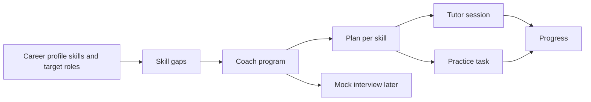
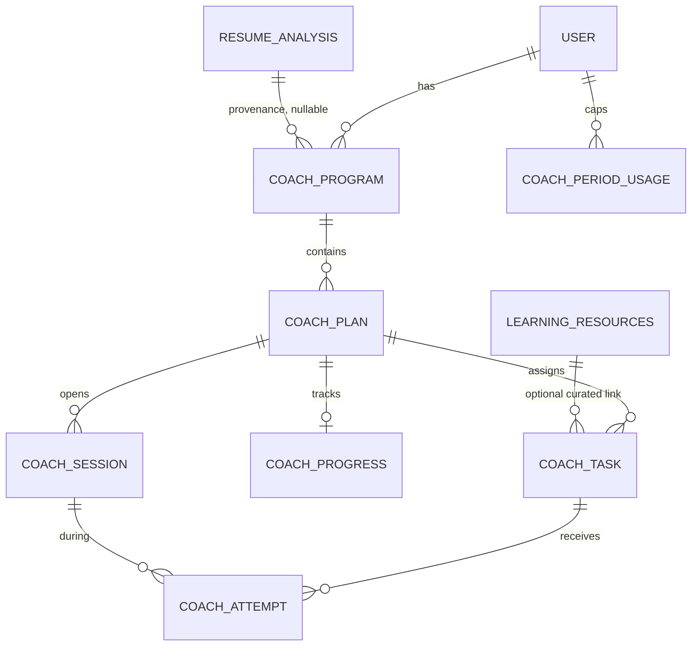

# Skill Coach

Status: design. No schema or product code in this change.
Owner: Skill Coach.
Reviewer: engineering head.
Depends on: Dashboard career profile (`docs/career-profile.md`, not in tree yet).

Skill Coach is the retention and paid loop for Zaprill's career-intelligence pivot. For each skill gap between a user's career profile and their target roles, it gives a learning plan, an AI tutor, practice tasks, progress, and later a mock interview. The free tier keeps the plan generous. Interactive coaching and mock interviews are paid.

This document does not define a profile schema and does not change `user`, `user_profile`, `resume`, or `resume_analysis`. Skills are referenced by the profile contract. Until that contract lands, section 4 states the interim key and marks every assumption.

## 1. What exists today

Gap analysis is a single request, not a learning product.

| Piece | Where | What it actually does |
| --- | --- | --- |
| Gap math | `aggregateSkillGaps` in `src/lib/match-engine.ts` | Counts missing skills across matched jobs. Priority is frequency: high above 50% of jobs, medium above 25%, else low. |
| Roadmap generation | `POST /api/analyze-gaps` | `generateText` with `openai("gpt-5-mini")`. The model filters naive gaps and returns `advice`, `relevantSkillGaps`, and `roadmap` as JSON. Zod validates the shape. A 7-day cache reuses `resume_analysis` when `resume_skills` and `inferred_job_titles` match, and logs a zero-token `analyze_gaps` row. |
| Persistence | `resume_analysis.skill_gaps`, `.roadmap`, `.advice` | JSON blobs on the analysis run. Nothing is a plan the user can resume tomorrow. |
| UI | `LearningRoadmap` on the Analyze "Learning Roadmap" tab | Renders priority, why, time, and resources. Expand and outbound clicks go to analytics only. No completion state. |
| Catalog | `learning_resources`, `resource_clicks`, `GET /api/r` | Curated rows keyed by a normalized skill string. `enhanceRoadmapResource` prefers an active catalog row and rewrites the link through `/api/r`. Otherwise a non-http URL becomes a Google search link. |
| Usage log | `ai_usage_log`, `logAiUsage` in `src/services/ai/usage.service.ts` | Append-only, fire-and-forget. Cost from `MODEL_RATES` (`gpt-5-mini`: $0.25 / 1M input, $2.00 / 1M output). |
| Agent pattern | `src/lib/agents/resume-architect.ts` and `POST /api/resumes/[id]/ai/chat` | `ToolLoopAgent`, `gpt-5-mini`, `reasoning: "low"`, `stopWhen: isStepCount(12)`, streamed with `createAgentUIStreamResponse`. Messages live in `resume_chat`. Usage logged as `resume_chat` from `onUsage`. No per-user turn cap. |
| Billing gate | `getSubscriptionWithAccess` | Binary. Any granting subscription is "pro". `plan.category` is `free`, `pro`, or `max`, and nothing in the coach path reads it. |
| Seed copy that code does not enforce | `src/scripts/seed-plans.ts` | Pro lists "1 skill test per week". Max lists "One-on-one AI coaching" and "Weekly career roadmap". No skill test, coach, or weekly plan exists. Prices are INR via Cashfree (Pro ₹49 / ₹129 / ₹399, Max ₹199 / ₹499 / ₹1499, GST 18% on paid plans). |
| Profile today | `user_profile` | Onboarding status, primary resume, raw resume JSON, `current_salary` (INR). Skills are a flat `text[]` on `resume_analysis`, edited as strings in profile review before analysis. |

`skill_category` and `skill_priority` enums already exist and match `SkillCategory` and the high/medium/low priority on `SkillGap` / `RoadmapItem`. They are not foreign keys. Coach may reuse the same string values. It must not invent a third vocabulary.

`ai_action` is a closed Postgres enum: `parse_resume`, `analyze_gaps`, `enhance_bullet`, `generate_summary`, `tailor_resume`, `ats_scan`, `resume_roast`, `resume_chat`. Coach calls need new values. Do not log them as `analyze_gaps` or `resume_chat`.

Analyze-gaps prompt rules worth keeping when a plan is generated: do not recommend skills the user already has; do not recommend HTML/CSS/JS basics when they already have a modern frontend stack; do not fill the plan with generic soft skills (Communication, Agile, Scrum, Teamwork); do not bolt on an unrelated stack.

Known constraint, not fixed here: `GET /api/r` increments `learning_resources.click_count` with a string-built SQL statement. Coach must not copy that. Clicks stay on the Drizzle insert into `resource_clicks` until that update is parameterized. Tracked as its own board card.

## 2. Product shape

One **program** per user and target role. One **plan** per skill gap inside that program. A plan has an outline (why, time, modules, resources), a tutor, practice tasks, and progress. Mock interviews are a later session type on the same program, not a separate product.



Persona changes tone, examples, and module length. It does not fork the schema.

| | Student / fresher | Job-switching professional |
| --- | --- | --- |
| Who | Final-year or recent graduate. Campus and off-campus placements in India. Little or no full-time experience. | Someone already in a role, usually 1–6 years, changing company or function. |
| Gap source | Target role vs a thin resume: DSA, SQL, one framework, project depth, and the basics the resume never proved. | Target role vs a real stack. Foundational skills they already use stay off the plan. The existing analyze-gaps exclusions apply. |
| Time | 45–90 minute sittings around college. Placement windows matter more than a weekly corporate cadence. | Short sittings around a job. Modules should transfer current work, not restart from a tutorial. |
| Success | Can explain the skill and finish a small task a fresher interviewer would ask. | Can show the skill on a problem shaped like the new role, then sit a mock. |
| Free hook | The full outline and curated free resources for one active program. | Same. The roadmap they already see on Analyze becomes a plan they can come back to. |
| Paid moment | Tutor cap, graded practice, and placement mocks in season. | Longer coaching and mocks for the switch. |

Both journeys start from the same place: an authenticated user who already has skills and at least one target role. Today that means a finished analysis (`resume_skills`, `inferred_job_titles`, `skill_gaps`, `roadmap`). After the profile contract lands, the same screen reads the profile instead of the analysis blob. Analyze keeps job match. Coach owns what happens after the gap list.

### 2.1 Student journey

1. Priya finishes profile review and analysis aimed at "SDE 1" / "Frontend Developer".
2. She opens Skill Coach. She sees one program for that role, the existing strategic `advice`, and a plan per relevant gap (for example React, SQL, DSA), sorted by the same priority the gap engine already computed.
3. The React plan explains why it matters for her roles, an estimated time, and a short module list. Resources are catalog links when `learning_resources` has the skill, otherwise the links analyze-gaps already stored.
4. She marks a module started. That is local progress, not a claim she knows React.
5. She asks the tutor one question ("how do I explain state to an interviewer"). Free daily turns cover a short session. The tutor stays on this plan. It does not rewrite her resume and does not invent internships or metrics.
6. She opens a practice task (explain or a small exercise). On the free tier she can read it. Grading is the Pro "skill test" the seed copy already promises.
7. Progress shows not started, in progress, practiced, or demonstrated for that plan only.
8. In placement season she hits a locked mock interview. That is Max (see section 6), with a paywall that leaves the plan itself readable.

Empty states: no analysis and no profile skills yet → send her to onboarding / Analyze, do not generate a generic syllabus. Zero gaps → a short "you match these roles" state and no tutor.

### 2.2 Professional journey

1. Arjun is a Java services developer targeting backend roles that want Kafka and system design. Analyze has already dropped HTML and Agile.
2. His program is tied to the target title he picked (profile review currently caps selected titles at 3; **Assumption:** the profile will expose the chosen targets explicitly).
3. Each plan's "why" must use his current stack as the base. Modules are shorter. Examples are production situations, not campus assignments.
4. `user_profile.current_salary` may inform tone if the profile contract exposes it (offer-gap context). Coach does not add a salary column and does not quote a number the profile did not provide.
5. He can hold more than one program only on a paid tier (section 6), because a switcher often has a primary target and a backup title.
6. Weekly refresh (Max seed copy) rebuilds outlines when the underlying gaps change. It does not wipe progress for a `skill_key` that is still in the gap list.
7. Mock interview, later, is a timed session against the target role, scored separately from lesson progress.

### 2.3 Shared rules

- Authenticated routes only (`auth.api.getSession`). Every row is scoped by `user_id`.
- API routes under `src/app/api/coach/...`. No Server Actions. Client components fetch those routes. Business logic in `src/services/coach/`.
- The tutor never writes the career profile, resume, subscription, or `learning_resources`.
- English UI. Tutor language is an open question (section 9).
- No emoji in UI copy.

## 3. Profile contract

Dashboard owns the profile. Skill Coach stores an opaque skill key and a display snapshot.

**Assumption A — skill identity.** The profile will expose a stable `skillKey` per skill the product believes the user has or is targeting. Coach never creates that table. Preferred shape we will read:

```ts
// Owned by docs/career-profile.md. Not a schema this feature creates.
type CareerProfileSkill = {
  skillKey: string;
  displayName: string;
  source: "resume" | "self_reported" | "inferred" | "verified";
};

type CareerProfileTarget = {
  roleKey: string; // Assumption B: stable id; may be job_titles.id
  title: string;
};
```

**Assumption B — role identity.** Targets have a stable `roleKey`. Until then, the normalized title string used in `resume_analysis.inferred_job_titles` is the key.

**Assumption C — gaps stay a computed view.** A gap is "target role requires this skill key, profile does not have it (or does not have it at a level the profile defines)". `aggregateSkillGaps` remains the producer until the profile owner replaces it. Coach consumes the result. It does not re-parse resumes.

**Assumption D — proficiency.** The profile may later have a level. Coach progress (`not_started | in_progress | practiced | demonstrated`) is evidence inside Coach. It is not the profile's proficiency and it is not written back unless the head and the profile owner agree (question 4).

**Assumption E — persona.** The profile will say whether the user is a student/fresher or a working professional, or it will expose years of experience and we will derive it. Threshold if we must derive it: zero full-time roles → `student`, otherwise `professional`. Stored on the program as a snapshot so a later profile edit does not rewrite history mid-plan.

**Assumption F — no soft-skill syllabus in v1.** Same exclusion as analyze-gaps. If the profile adds soft skills, Coach ignores them until we explicitly allow the category.

### 3.1 Interim key, until `docs/career-profile.md` exists

| Field | Interim value | Replace when |
| --- | --- | --- |
| `skill_key` | `normalizeSkill(gap.skill)` from `src/lib/skill-extractor.ts` (lowercase, alias map) | Profile publishes `skillKey` |
| `display_name` | The skill string on the roadmap item | Profile `displayName` |
| `role_key` | Lowercased trimmed `inferred_job_titles[]` entry the user selected | Profile `roleKey` |
| Gap evidence | `{ frequency, priority, category }` copied from `SkillGap` | Profile or match engine emits the same evidence |
| Provenance | `source_analysis_id` → `resume_analysis.id` | Nullable once gaps come from the profile with no analysis row |

Mapping rule when the real key arrives: one function, reviewed with Dashboard, updates `skill_key` where the interim key matches. Coach does not keep a second taxonomy. `SKILLS_TAXONOMY` stays the match engine's concern.

Do not foreign-key `skill_key` or `role_key` to tables this feature does not own.

## 4. Data model

New tables only. Drizzle in `src/db/schema.ts`, migration when phase 1 starts. IDs are nanoids, same as the rest of the app. Timestamps `created_at` / `updated_at`.



### 4.1 `coach_program`

One active learning container for a user and a target role.

| Column | Type | Notes |
| --- | --- | --- |
| `id` | text pk | |
| `user_id` | text fk → `user.id` cascade | |
| `role_key` | text | Opaque. Assumption B. |
| `role_title` | text | Snapshot for UI. |
| `persona` | text | `student` or `professional`. Check constraint. |
| `status` | text | `active`, `paused`, `archived`. |
| `advice` | text | Role-level guidance. Copied from `resume_analysis.advice` in phase 1. |
| `source_analysis_id` | text fk → `resume_analysis.id` set null | Provenance only. |
| `gap_fingerprint` | text | Hash of sorted `skill_key`s. Used to skip pointless regeneration. |

Unique: `(user_id, role_key)` where `status = 'active'`. A second active program is an entitlement decision, enforced in the service, not by a global unique on `user_id`.

### 4.2 `coach_plan`

One skill gap inside a program.

| Column | Type | Notes |
| --- | --- | --- |
| `id` | text pk | |
| `program_id` | text fk cascade | |
| `user_id` | text fk cascade | Denormalized so session routes do not join to authorize. |
| `skill_key` | text | Opaque. Section 3. |
| `display_name` | text | Snapshot. |
| `priority` | text | `high`, `medium`, `low`. Same values as `skill_priority`. |
| `category` | text | Same values as `skill_category`. |
| `status` | text | `active`, `completed`, `archived`. |
| `outline` | jsonb | Zod-validated. Shape below. |
| `outline_generated_at` | timestamp | |
| `gap_evidence` | jsonb | `{ frequency?: number, source: "job_match" \| "target_role" \| "self_selected" }`. `self_selected` is unused until the profile allows the user to add a gap. |

Unique: `(program_id, skill_key)`.

`outline` matches what `LearningRoadmap` can render, plus modules:

```ts
{
  why: string;
  estimatedTime: string; // same loose string analyze-gaps already returns, e.g. "2-4 weeks"
  modules: Array<{
    key: string;          // stable within the plan, e.g. "m1"
    title: string;
    objective: string;
    estimatedMinutes: number;
    resources: LearningResource[]; // existing type in src/types/index.ts
  }>;
}
```

Phase 1 may store a single module copied from today's `RoadmapItem` so the current component still works. `LearningResource.type` stays `course | book | tutorial | documentation | practice`.

### 4.3 `coach_progress`

One row per plan.

| Column | Type | Notes |
| --- | --- | --- |
| `plan_id` | text pk / fk cascade | |
| `user_id` | text fk | |
| `skill_key` | text | Copy of the plan key, for queries. |
| `state` | text | `not_started`, `in_progress`, `practiced`, `demonstrated`. |
| `current_module_key` | text nullable | |
| `tasks_attempted` | integer default 0 | |
| `tasks_passed` | integer default 0 | |
| `last_session_at` | timestamp nullable | |
| `mastery_score` | integer nullable | 0–100. Null until a graded attempt exists. Not a profile field. |

`demonstrated` means the latest graded attempt passed a threshold (proposed 70). It does not update the career profile.

### 4.4 `coach_session`

A tutor thread or, later, a mock. Same persistence idea as `resume_chat.messages` (AI SDK UI messages).

| Column | Type | Notes |
| --- | --- | --- |
| `id` | text pk | |
| `plan_id` | text fk cascade nullable | Null only for a program-level mock in phase 4. |
| `program_id` | text fk cascade | |
| `user_id` | text fk cascade | |
| `kind` | text | `tutor` now. `mock_interview` in phase 4. Practice grading is not a chat. |
| `status` | text | `active`, `completed`, `abandoned`. |
| `messages` | jsonb default `[]` | UI messages. |
| `summary` | text nullable | Compressed older turns. The model sees summary + last 8 messages, not the full thread. |
| `module_key` | text nullable | Tutor is pinned to one module per session. |
| `turn_count` | integer default 0 | User turns. Incremented in the same transaction as the quota. |
| `started_at` / `ended_at` | timestamp | |

### 4.5 `coach_task` and `coach_attempt`

Phase 2. A task is generated once and reused. Attempts are the user's submissions.

`coach_task`: `id`, `plan_id`, `module_key`, `kind` (`explain` | `exercise`), `prompt` (shown to the user), `rubric` jsonb (**server only**, never returned to the client), `resource_id` nullable fk → `learning_resources.id` set null, `created_at`.

`coach_attempt`: `id`, `task_id`, `session_id` nullable, `user_id`, `answer` text, `score` integer nullable, `feedback` text, `passed` boolean nullable, `created_at`.

Generation of the task is one `generateText` call. Grading is another, with structured output (`Output` + Zod, the pattern in `src/app/api/parse-resume/route.ts`), not the hand-rolled `extractJSON` path in analyze-gaps.

### 4.6 `coach_period_usage`

Quota source of truth. `ai_usage_log` is the audit trail. Do not gate by scanning the log: it is fire-and-forget and will race.

| Column | Type | Notes |
| --- | --- | --- |
| `user_id` | text | |
| `period_start` | date | UTC date for daily counters. Weekly counters use ISO week start stored in `week_start`. |
| `tutor_turns` | integer default 0 | |
| `practice_grades` | integer default 0 | |
| `plan_generations` | integer default 0 | |
| `mock_sessions` | integer default 0 | Phase 4. Month bucket can be a separate row with `period_kind`. |

Primary key `(user_id, period_kind, period_start)` with `period_kind` in `day | week | month`.

Allow a turn with a single update: `UPDATE ... SET tutor_turns = tutor_turns + 1 WHERE tutor_turns < $cap RETURNING`. Zero rows means the cap was hit. Insert-on-conflict for the first turn of the period. Do this **before** the model call. Refund the increment if the model call throws (decrement in a catch). Log the failure either way.

### 4.7 What we will not store

- A skills table, a role table, or a copy of the profile.
- Raw resume text on coach rows. The tutor receives the skill snapshot and the module, not `resume_raw`.
- Subscription or invoice data. Entitlement is read from `getSubscriptionWithAccess` plus `plan.category`.

## 5. AI tutor

### 5.1 Layout

```
src/lib/agents/skill-coach.ts          ToolLoopAgent
src/lib/agents/skill-coach-tools.ts    tools closed over a CoachContext
src/services/coach/plan.service.ts     programs, plans, progress
src/services/coach/entitlement.service.ts
src/services/coach/context.service.ts  the snapshot handed to the model
src/app/api/coach/programs/route.ts
src/app/api/coach/plans/[id]/route.ts
src/app/api/coach/plans/[id]/sessions/route.ts   stream, POST + GET
src/app/api/coach/tasks/[id]/attempts/route.ts   grade, POST
```

Model constant: `gpt-5-mini`, same as Resume Architect and analyze-gaps. `reasoning: "low"`. `maxDuration = 60` on the session route.

Streaming copies the architect route: `createAgentUIStreamResponse`, `smoothStream({ chunking: "word" })`, persist messages `onEnd`, `logAiUsage` from agent `onUsage`. Abort on client disconnect still persists, as architect does.

### 5.2 Tools

The agent may only call these. Step cap `isStepCount(6)` (architect allows 12; a tutor reply should be one read plus at most one write).

| Tool | Effect |
| --- | --- |
| `getLearningContext` | Returns persona, role title, `skill_key`, display name, outline module, progress state, and the rolling summary. No resume, no salary, no other users. |
| `listCuratedResources` | Active `learning_resources` for this `skill_key`. Returns name, type, free flag, and `/api/r?id=` when a row exists. No web search. |
| `getProgress` | The one progress row. |
| `setModuleStatus` | Moves `current_module_key` and state from `not_started` to `in_progress` only. Cannot set `demonstrated`. |
| `recordTutorNote` | Appends a short note onto the session summary draft. Does not grade. |

Grading is **not** a tool inside the tutor loop. A tutor that can grade will spend steps and tokens negotiating the score. `POST .../attempts` is one structured `generateText` with the rubric server-side.

The tutor must not invent employers, dates, degrees, or metrics. If the user asks to edit a resume, point them at Resume Architect. If they ask for a skill outside this plan, tell them to open that plan. If a resource URL is not in the catalog or the stored outline, name the resource and say there is no verified link. Do not emit a new URL. That is the failure mode `enhanceRoadmapResource` already papers over with Google search.

System prompt is persona-specific (student examples vs transfer-from-current-job examples) and pinned to one module. It repeats the analyze-gaps exclusions so the tutor does not "helpfully" add HTML or Agile.

### 5.3 Context budget

Per tutor turn the model sees:

1. System instructions (fixed).
2. Learning context (one module, not every plan in the program).
3. Session summary, if present.
4. The last 8 UI messages.

When `messages` exceed 16, a separate `generateText` compresses the older half into `coach_session.summary` and logs `coach_tutor` with `metadata.kind = "summary"`. Cap summary at ~150 words. `maxOutputTokens`: 600 for a tutor reply, 250 for a summary, 400 for a grade.

Plan generation (phase 1, only when the analysis has no roadmap we can copy, or on an explicit regenerate) is one `generateText`, Zod-parsed, cached when `gap_fingerprint` is unchanged and `outline_generated_at` is inside 7 days. That window matches the analyze-gaps cache on purpose. Cache hits call `logAiUsage` with `cacheHit: true` and zero tokens.

### 5.4 Cost controls

`gpt-5-mini` is cheap per call. A 20-turn tutor session at roughly 3k input and 0.5k output is about $0.0018 at the rates in `MODEL_RATES`. Abuse and forgotten loops are the risk, not the unit price. Mock interviews will be longer; they stay on the same model until a quality review says otherwise (question 6).

Controls, in order:

1. Entitlement check, then the atomic quota update, then the model call.
2. Step cap 6. Output token caps above.
3. No tool that fetches the open web or the full resume.
4. One in-flight session per plan. A second POST while `status = active` and `updated_at` is under 2 minutes returns the existing session id.
5. Daily and weekly caps in section 6. Free plan generation: 1 per 7 days per program.
6. Failed Zod parse logs `success: false`, `errorCode: "SCHEMA_VALIDATION_FAILED"`, and does not increment a second time (the refund path in 4.6 covers the throw; a soft parse failure still consumed the model, so the quota stays spent and the user sees a retry that counts).

### 5.5 Usage logging

Extend `ai_action` and the `LogUsageParams.action` union together:

| Action | When |
| --- | --- |
| `coach_plan` | Outline generation or regenerate. |
| `coach_tutor` | Each tutor turn, and the summary compression. |
| `coach_practice` | Task generation and each grade. |
| `coach_mock` | Phase 4 only. Do not add the enum value until that phase ships, so dashboards do not show a dead action. |

`metadata` on every row: `{ programId, planId, sessionId, skillKey, turnIndex, tier }` where the id exists. `tier` is `free | pro | max` at call time. `analysisId` stays null unless this call is explicitly tied to a `resume_analysis` regeneration; do not overload that foreign key for sessions.

`logAiUsage` stays fire-and-forget. Quota accounting does not.

Postgres note for the migration: `ALTER TYPE ai_action ADD VALUE` cannot be used in the same transaction that inserts the new value. Add the values in their own migration, ship code that writes them only after that migration is applied.

Admin stats that `SUM(total_tokens)` from `ai_usage_log` keep working. Add a breakdown by the new actions when phase 2 lands so coaching cost is visible next to parse and analyze.

## 6. Monetization

Free tier is the plan. Paid tier is the coach talking back, grading, and (later) interviewing.

Today any granting subscription flips `isPro`, and Analyze hides apply URLs above a 50% match for everyone else. Coach must not reuse that trick on learning content. A free user who generated a plan keeps that plan, including the why and the resources. The paywall is on the next interactive action.

Read tier like this:

- No granting subscription → `free`.
- Granting subscription whose `plan.category` is `pro` → `pro`.
- `max` → `max`.
- Unknown category with a granting subscription → treat as `pro` and log it. Do not fail open to max.

Seed marketing already sold two coach behaviors. The gates below honor that copy instead of inventing a fourth product.

| Capability | Free | Pro | Max |
| --- | --- | --- | --- |
| Active programs | 1 | 3 | 5 |
| Plans inside a program | All current gaps | All | All |
| Outline, why, curated resources | Yes | Yes | Yes |
| Regenerate outline | 1 per 7 days | 1 per 7 days | Weekly refresh included (does not count against the 7-day manual cap) |
| Tutor turns | 8 / day | 40 / day | 80 / day |
| Graded practice | 0. The task prompt is visible. | 1 / week. This is the seed line "1 skill test per week". | 4 / week |
| Mock interview | No | No | 2 / month. Phase 4. This is the seed line "One-on-one AI coaching". |
| Job apply-link lock | Unchanged | Unchanged | Unchanged |

Numbers are a proposal (question 1). Implementation constants live in `entitlement.service.ts`, keyed by tier. Do not parse `plan.features` jsonb. Those bullets are billing-page copy and will drift.

When a cap hits, the API returns 403 with `{ error: "COACH_LIMIT", capability, tier, upgradeTo }`. The client shows an upgrade card into the existing checkout (`plan` rows, Cashfree, INR, GST). No new payment provider. No credits wallet in v1. `subscription.metadata` is reserved for a future credit system and stays empty.

Canceled subscriptions keep coach access until `subscriptionGrantsAccess` says they do, same as the rest of the product.

Affiliate revenue on `learning_resources` stays a side effect of `/api/r`. It is not the paywall. Prefer `is_free = true` rows in the outline, matching the analyze-gaps prompt ("Prefer free resources").

## 7. Phased plan

Each phase ships behind the API and is burn-in tested on a student-shaped account and a professional-shaped account before the board card moves to Done. Profile tables stay untouched in every phase.

### Phase 0 — this document

Agree the contract assumptions and the gate table. Unblock condition for phase 1 schema: either `docs/career-profile.md` names `skillKey` / `roleKey`, or the head accepts the interim keys in section 3.1 in writing.

### Phase 1 — a plan you can leave and come back to

- Tables: `coach_program`, `coach_plan`, `coach_progress`. No agent.
- Create a program from the latest `resume_analysis` for the user: one plan per roadmap item, `skill_key` via `normalizeSkill`, outline as a single module, progress `not_started`.
- If a 7-day fingerprint match exists, return it and do not call the model.
- UI: a Coach surface that lists programs and renders outlines with `LearningRoadmap` (or a thin wrapper). Analyze's roadmap tab links here instead of being the only copy of the plan.
- Entitlement: free = 1 active program. Over the cap → 403 `COACH_LIMIT` without deleting the existing one.
- No new `ai_action` unless a regenerate actually calls the model; then `coach_plan`.

Done when a user can refresh the page and see the same plans, mark a module in progress, and hit the program cap.

### Phase 2 — tutor and practice

- Tables: `coach_session`, `coach_task`, `coach_attempt`, `coach_period_usage`.
- Enum values `coach_plan` (if not already), `coach_tutor`, `coach_practice`.
- Agent, tools, quotas, streaming route, attempt route.
- Pro weekly grade matches the seed bullet. Free sees the prompt and the lock.
- Usage rows visible in the existing admin token stats.

Done when a capped free user cannot get an 9th tutor turn, a Pro user can get one graded attempt in the week, both are logged with cost, and the tutor cannot set `demonstrated` by chatting.

### Phase 3 — loop and catalog

- Weekly Max refresh: recompute gaps, archive plans whose `skill_key` disappeared, add plans for new keys, keep progress when the key remains.
- Module resources prefer `learning_resources`. Stop writing Google search URLs into new outlines.
- `mastery_score` and `demonstrated` only from passed attempts.
- Fix the `/api/r` click counter with a parameterized update before Coach sends more traffic through it. That fix is a separate change.

### Phase 4 — mock interview

- `coach_session.kind = mock_interview`, action `coach_mock`.
- Program-level, not pinned to one module. Rubric stored server-side. Stricter output cap and a max of ~15 model turns, still `stopWhen` bounded.
- Max quota only, unless question 6 changes the packaging.
- Separate prompt. The lesson tutor does not become the interviewer.

Out of scope for all phases: human expert review (the other Max bullet), a content CMS, replacing Adzuna job search, Hindi/regional UI chrome, and any write into the career profile.

## 8. Non-goals

- A private skill taxonomy or profile tables "until Dashboard is ready".
- Logging coach traffic as `resume_chat` or `analyze_gaps`.
- Gating by `SELECT count(*) FROM ai_usage_log`.
- Letting the model invent course URLs.
- Hiding a free user's plan the way Analyze hides apply URLs.
- A new Cashfree plan or credit pack in the first three phases.

## 9. Open questions for the head

1. **Caps.** Are the free / pro / max numbers in section 6 right? In particular 8 free tutor turns per day, and mock interviews only on Max.
2. **Pro vs Max copy.** Seed data already promises a weekly skill test on Pro and AI coaching on Max. This design follows that. If coaching should be every paid plan, say so before phase 2.
3. **Interim keys.** Can phase 1 ship on `normalizeSkill` + inferred title strings if `docs/career-profile.md` is not merged, or does Coach wait?
4. **Write-back.** When a plan reaches `demonstrated`, does Dashboard want an event, or does proficiency stay entirely on their side?
5. **Persona source.** Will the profile have an explicit student vs professional flag, or do we derive it from experience?
6. **Mock packaging and model.** Is 2 mocks / month on Max the product, or a one-off INR purchase? Do we stay on `gpt-5-mini` for mocks?
7. **Tutor language.** English only, or Hinglish replies when the user writes that way? UI chrome stays English either way.
8. **Who emits gaps after the profile exists?** Coach keeps calling the match engine, or the profile service returns the gap list and Coach stops reading `resume_analysis.skill_gaps`?
9. **Multiple targets.** Profile review allows 3 titles. Is one active program the free unit (this doc), or one program with three roles inside it?
10. **Placement deadline.** Should a student program store a target date (campus season), or is that profile data we only display?
11. **Soft skills.** Confirm they stay out of v1 even if a non-tech target role shows up in the profile.
12. **Human review on Max.** Confirm that stays outside Skill Coach.
