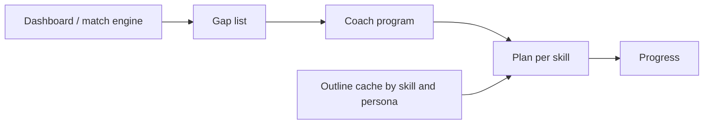
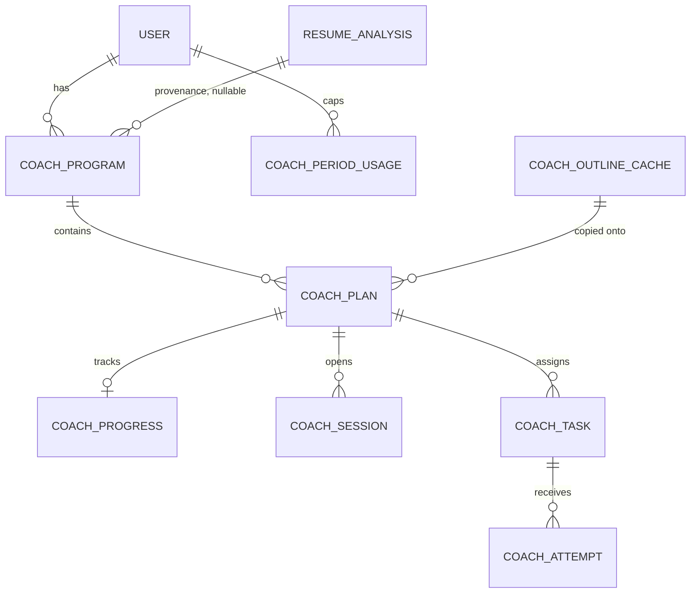

# Skill Coach

Status: design approved with changes. This change is the revised doc only.
Owner: Skill Coach.
Reviewer: engineering head.
Depends on: Dashboard career profile (`docs/career-profile.md`, not in tree yet).

**Do not start phase 1 code until `docs/career-profile.md` is merged.** Phase 1 (saved plans, no model calls, interim keys) is approved. The first implementation task is to check assumptions A–F against that file. Where the contract disagrees with an assumption, the contract wins and this doc is updated before any migration.

Skill Coach is the retention and paid loop for Zaprill's career-intelligence pivot. For each skill gap between a user's career profile and their target roles, it gives a learning plan, an AI tutor, practice tasks, progress, and later a mock interview. The free tier keeps the plan. Interactive coaching and mock interviews are paid.

This document does not define a profile schema and does not change `user`, `user_profile`, `resume`, or `resume_analysis`. Skills are referenced by the profile contract.

## 1. What exists today

Gap analysis is a single request, not a learning product.

| Piece | Where | What it actually does |
| --- | --- | --- |
| Gap math | `aggregateSkillGaps` in `src/lib/match-engine.ts` | Counts missing skills across matched jobs. Priority is frequency: high above 50% of jobs, medium above 25%, else low. This engine, behind the Dashboard profile, is the only gap source Coach will read. |
| Roadmap generation | `POST /api/analyze-gaps` | `generateText` with `openai("gpt-5-mini")`. The model filters naive gaps and returns `advice`, `relevantSkillGaps`, and `roadmap` as JSON. Zod validates the shape. A 7-day cache reuses `resume_analysis` when `resume_skills` and `inferred_job_titles` match, and logs a zero-token `analyze_gaps` row. |
| Persistence | `resume_analysis.skill_gaps`, `.roadmap`, `.advice` | JSON blobs on the analysis run. Nothing is a plan the user can resume tomorrow. |
| UI | `LearningRoadmap` on the Analyze "Learning Roadmap" tab | Renders priority, why, time, and resources. Expand and outbound clicks go to analytics only. No completion state. |
| Catalog | `learning_resources`, `resource_clicks`, `GET /api/r` | Curated rows keyed by a normalized skill string. `enhanceRoadmapResource` prefers an active catalog row and rewrites the link through `/api/r`. Otherwise a non-http URL becomes a Google search link. |
| Usage log | `ai_usage_log`, `logAiUsage` in `src/services/ai/usage.service.ts` | Append-only, fire-and-forget. `MODEL_RATES` prices `gpt-5-mini` at $0.25 / 1M input and $2.00 / 1M output. The logger bills `inputTokens` and `outputTokens` only. It does not record reasoning tokens. |
| Agent pattern | `src/lib/agents/resume-architect.ts` and `POST /api/resumes/[id]/ai/chat` | `ToolLoopAgent`, `gpt-5-mini`, `reasoning: "low"`, `stopWhen: isStepCount(12)`, streamed with `createAgentUIStreamResponse`. One `onEnd` usage callback logs the loop as a single `resume_chat` row. No per-user turn cap. |
| Billing gate | `getSubscriptionWithAccess` | Binary. Any granting subscription is "pro". `plan.category` is `free`, `pro`, or `max`, and nothing in the coach path reads it. |
| Plan copy | `plan.features` and `src/scripts/seed-plans.ts` | Marketing bullets and INR prices (Cashfree, GST 18% on paid plans). Copy today mentions a weekly skill test and AI coaching. Those sentences are not entitlements. Prices will change. Coach limits do not read them. |
| Settings switch | `app_settings`, `referral_enabled` in `src/lib/app-settings.ts` | Admin key-value flags. Coach kill switch follows this pattern. |
| Profile today | `user_profile` | Onboarding status, primary resume, raw resume JSON, `current_salary` (INR). Skills are a flat `text[]` on `resume_analysis`, edited as strings in profile review before analysis. |

`skill_category` and `skill_priority` enums already exist and match `SkillCategory` and the high/medium/low priority on `SkillGap` / `RoadmapItem`. They are not foreign keys. Coach reuses those string values.

`ai_action` is a closed Postgres enum: `parse_resume`, `analyze_gaps`, `enhance_bullet`, `generate_summary`, `tailor_resume`, `ats_scan`, `resume_roast`, `resume_chat`. Coach calls need new values. Do not log them as `analyze_gaps` or `resume_chat`.

Known constraint, not fixed here: `GET /api/r` increments `learning_resources.click_count` with a string-built SQL statement. Coach must not copy that. Clicks stay on the Drizzle insert into `resource_clicks` until that update is parameterized. Tracked as its own board card.

## 2. Product shape

One **program** per user and target role. One **plan** per skill gap inside that program. A plan has an outline (why, time, modules, resources), a tutor, practice tasks, and progress. Mock interviews are a later session type, noted in phase 4, not designed here.



Persona changes tone and which cached outline is copied. It is read from the profile on each request. It is not a column on coach tables.

| | Student / fresher | Job-switching professional |
| --- | --- | --- |
| Who | Final-year or recent graduate. Campus and off-campus placements in India. Little or no full-time experience. | Someone already in a role, usually 1–6 years, changing company or function. |
| Gap source | The Dashboard / match engine list for their target role. | The same list. Foundational skills they already have are the engine's job to omit. |
| Time | 45–90 minute sittings around college. | Short sittings around a job. Tutor examples use transfer from current work. |
| Success | Can explain the skill and finish a small task a fresher interviewer would ask. | Can show the skill on a problem shaped like the new role. |
| Free hook | The full outline and curated free resources for one active program. | Same. The roadmap on Analyze becomes a plan they can come back to. |
| Paid moment | Tutor cap, graded practice, and later mocks. | Higher caps in the same config. |

Both journeys start from an authenticated user who already has a gap list. Today that list is `resume_analysis.skill_gaps` written by analyze-gaps. After the profile contract lands, Coach reads the gap view that contract names. Coach does not compute a second list.

### 2.1 Student journey

1. Priya finishes profile review and analysis aimed at "SDE 1" / "Frontend Developer".
2. She opens Skill Coach. She sees one program for that role, the engine's `advice`, and a plan per gap (for example React, SQL, DSA), in the engine's priority order.
3. The React plan shows why, an estimated time, and a short module list. Phase 1 copies that from the engine's roadmap item. Phase 2 may replace it from the shared outline cache for `(react, student)`.
4. She marks a module started. That is progress on the plan, not a claim on her profile.
5. She asks the tutor one question. The daily turn cap and the monthly INR ceiling both apply. The tutor stays on this plan.
6. She can read a practice task. Grading counts against the graded-practice limit in `COACH_LIMITS`.
7. If her profile gaps change, plans reconcile for her the same way they do for a paying user (section 4.8).
8. Progress shows not started, in progress, practiced, or demonstrated for that plan only.

Empty states: no gap list yet → send her to onboarding / Analyze. Zero gaps → a short "you match these roles" state and no tutor.

### 2.2 Professional journey

1. Arjun is a Java services developer targeting backend roles that want Kafka and system design. The engine has already dropped HTML and Agile.
2. His program is tied to the target title he picked (profile review currently caps selected titles at 3; **Assumption B**).
3. Persona is whatever the profile says he is on this request. Tutor examples stay in the professional voice while that read is `professional`.
4. `user_profile.current_salary` is not an input. Coach does not add a salary column.
5. He can hold more programs only when `COACH_LIMITS` for his tier says so.
6. A profile or gap-list change reconciles his plans. Progress for a `skill_key` that is still present is kept. This is not a Max-only refresh.
7. Mock interviews are phase 4 and are not part of this journey yet.

### 2.3 Shared rules

- Authenticated routes only (`auth.api.getSession`). Every row is scoped by `user_id`.
- API routes under `src/app/api/coach/...`. No Server Actions. Client components fetch those routes. Business logic in `src/services/coach/`.
- The tutor never writes the career profile, resume, subscription, or `learning_resources`.
- English UI. Tutor language is an open question (section 9).
- No emoji in UI copy.
- Saved plans stay readable when the kill switch is off and when a cap is hit. The paywall is the next model call, not the outline.

## 3. Profile contract

Dashboard owns the profile. The match engine is the only producer of gaps. Skill Coach stores an opaque skill key and a display snapshot taken from that gap list.

When `docs/career-profile.md` lands, re-read A–F against it before writing schema. Do not treat this section as frozen if the contract uses different names.

**Assumption A — skill identity.** The profile exposes a stable `skillKey` per skill. Coach never creates that table. Shape we expect to read:

```ts
// Owned by docs/career-profile.md. Not a schema this feature creates.
type CareerProfileSkill = {
  skillKey: string;
  displayName: string;
  source: "resume" | "self_reported" | "inferred" | "verified";
};

type CareerProfileTarget = {
  roleKey: string; // Assumption B
  title: string;
};
```

If the merged contract already defines `skillKey`, phase 1 uses that and does not write `normalizeSkill` keys.

**Assumption B — role identity.** Targets have a stable `roleKey`. Until the contract defines one, the normalized title string in `resume_analysis.inferred_job_titles` is the key.

**Assumption C — one gap source.** A gap is a skill key the Dashboard / match engine says is missing for a target role. Coach consumes that list. Coach does not call `aggregateSkillGaps`, does not re-parse resumes, and does not keep a second gap algorithm. Interim read, only if the contract has no gap view yet: the latest `resume_analysis.skill_gaps` and `roadmap` that the engine already stored.

**Assumption D — proficiency.** The profile may later have a level. Coach progress (`not_started | in_progress | practiced | demonstrated`) stays inside Coach. It is not written back unless the head and the profile owner agree (question 2).

**Assumption E — persona.** The profile says whether the user is a student/fresher or a working professional, or it exposes enough experience that a reader can derive it. Derivation if the contract has no flag: zero full-time roles → `student`, otherwise `professional`. Coach reads this on each request through one adapter. It is not stored on `coach_program`, `coach_plan`, or `coach_progress`. The outline cache key uses the value from that read.

**Assumption F — no soft-skill syllabus in v1.** Same exclusion as analyze-gaps. If the profile adds soft skills, Coach ignores them until we explicitly allow the category.

### 3.1 Interim keys

Approved for phase 1 only as the fallback when the merged contract still has no stable skill or role id.

| Field | Fallback | Drop when |
| --- | --- | --- |
| `skill_key` | `normalizeSkill(gap.skill)` from `src/lib/skill-extractor.ts` | Contract publishes `skillKey` |
| `display_name` | Skill string on the engine roadmap item | Contract `displayName` |
| `role_key` | Lowercased trimmed selected `inferred_job_titles` entry | Contract `roleKey` |
| Gap evidence | `{ frequency, priority, category }` copied from the engine `SkillGap` | Engine emits the same evidence under the contract |
| Provenance | `source_analysis_id` → `resume_analysis.id` | Nullable once the gap list is not an analysis row |

Do not foreign-key `skill_key` or `role_key` to tables this feature does not own. Do not keep a Coach taxonomy next to `SKILLS_TAXONOMY`.

## 4. Data model

New tables only. Drizzle in `src/db/schema.ts`, migration when phase 1 is allowed to start. IDs are nanoids. Timestamps `created_at` / `updated_at`.



### 4.1 `coach_program`

One active learning container for a user and a target role.

| Column | Type | Notes |
| --- | --- | --- |
| `id` | text pk | |
| `user_id` | text fk → `user.id` cascade | |
| `role_key` | text | Opaque. Assumption B. |
| `role_title` | text | Snapshot for UI. |
| `status` | text | `active`, `paused`, `archived`. |
| `advice` | text | Role-level guidance copied from the gap source. Not the shared outline. |
| `source_analysis_id` | text fk → `resume_analysis.id` set null | Provenance only. |
| `gap_fingerprint` | text | Hash of sorted `skill_key`s last applied. Refresh no-ops when it matches. |

No persona column. Unique: `(user_id, role_key)` where `status = 'active'`. A second active program is enforced in the service from `COACH_LIMITS`.

### 4.2 `coach_plan`

One skill gap inside a program.

| Column | Type | Notes |
| --- | --- | --- |
| `id` | text pk | |
| `program_id` | text fk cascade | |
| `user_id` | text fk cascade | Denormalized so session routes can authorize without a join. |
| `skill_key` | text | Opaque. Section 3. |
| `display_name` | text | Snapshot. |
| `priority` | text | `high`, `medium`, `low`. |
| `category` | text | `skill_category` values. |
| `status` | text | `active`, `completed`, `archived`. |
| `outline` | jsonb | Zod-validated snapshot copied onto the plan. |
| `outline_source` | text | `gap_roadmap` (phase 1) or `shared_cache` (phase 2). |
| `gap_evidence` | jsonb | Copied from the engine. `{ frequency?: number, source: "job_match" \| "target_role" }`. |

Unique: `(program_id, skill_key)`.

```ts
{
  why: string;
  estimatedTime: string;
  modules: Array<{
    key: string;
    title: string;
    objective: string;
    estimatedMinutes: number;
    resources: LearningResource[]; // src/types/index.ts
  }>;
}
```

Phase 1 stores one module copied from the engine `RoadmapItem` when the skill matches, otherwise a shell (`why` empty, one module titled with `display_name`). Phase 1 never calls a model to fill a shell. `LearningResource.type` stays `course | book | tutorial | documentation | practice`.

### 4.3 `coach_progress`

One row per plan. `skill_key` is not copied here. Callers that need the skill join `coach_plan`. No query in this design filters progress by skill without the plan.

| Column | Type | Notes |
| --- | --- | --- |
| `plan_id` | text pk / fk cascade | |
| `user_id` | text fk | Authorize without joining when the route already has the user. |
| `state` | text | `not_started`, `in_progress`, `practiced`, `demonstrated`. |
| `current_module_key` | text nullable | |
| `tasks_attempted` | integer default 0 | |
| `tasks_passed` | integer default 0 | |
| `last_session_at` | timestamp nullable | |
| `mastery_score` | integer nullable | 0–100. Null until a graded attempt exists. Not a profile field. |

`demonstrated` means the latest graded attempt passed a threshold (proposed 70). It does not update the career profile.

### 4.4 `coach_outline_cache`

Shared across users. One outline per skill and persona. Phase 2. Phase 1 does not write it, because phase 1 outlines are per-user snapshots from the engine and would poison the cache.

| Column | Type | Notes |
| --- | --- | --- |
| `skill_key` | text | |
| `persona` | text | `student` or `professional`. From the profile read at fill time. |
| `outline` | jsonb | Same shape as `coach_plan.outline`. |
| `model` | text | |
| `generated_at` | timestamp | |

Primary key `(skill_key, persona)`.

A hit copies `outline` onto that user's plan and logs `coach_plan` with `cacheHit: true` and zero tokens. A miss is one `generateText`, Zod-parsed, then inserted. The cached why is persona-level, not a biography. Personalized role guidance stays on `coach_program.advice`.

Do not key the cache by user, role, or salary. Two students missing React share one outline.

### 4.5 `coach_session`, tasks, attempts

Phase 2, except the mock kind.

`coach_session`: `id`, `plan_id`, `program_id`, `user_id`, `kind` (`tutor`), `status` (`active | completed | abandoned`), `messages` jsonb (AI SDK UI messages, same idea as `resume_chat`), `summary` text nullable, `module_key`, `turn_count`, `started_at`, `ended_at`.

`coach_task`: `id`, `plan_id`, `module_key`, `kind` (`explain | exercise`), `prompt` (shown to the user), `rubric` jsonb (server only), `resource_id` nullable fk → `learning_resources.id`, `created_at`. Generated once per task.

`coach_attempt`: `id`, `task_id`, `session_id` nullable, `user_id`, `answer`, `score`, `feedback`, `passed`, `created_at`.

Grading uses structured `generateText` (`Output` + Zod, as in `src/app/api/parse-resume/route.ts`). It is not a tool inside the tutor loop.

### 4.6 `coach_period_usage`

Quota and spend source of truth. `ai_usage_log` is the audit trail. Do not gate by scanning the log.

| Column | Type | Notes |
| --- | --- | --- |
| `user_id` | text | |
| `period_kind` | text | `day`, `week`, `month`. |
| `period_start` | date | UTC day, ISO week start, or UTC month start. |
| `tutor_turns` | integer default 0 | Day rows. |
| `practice_grades` | integer default 0 | Week rows. |
| `spend_paise` | integer default 0 | Month rows. Reserved, then reconciled to actual. |

Primary key `(user_id, period_kind, period_start)`.

Turn allow: `UPDATE ... SET tutor_turns = tutor_turns + 1 WHERE tutor_turns < $cap RETURNING`. Zero rows means the cap was hit. Same pattern for grades. Spend reservation is in section 5.4.

### 4.7 What we will not store

- A persona column on program, plan, or progress.
- `skill_key` on progress.
- A skills table, a role table, or a copy of the profile.
- Raw resume text on coach rows.
- Subscription prices or `plan.features` as limits.

### 4.8 Gap refresh

Runs for every tier whenever the gap source changes. Not a scheduled Max job.

1. Read the new gap list from the Dashboard / match engine (assumption C).
2. If `gap_fingerprint` is unchanged, stop.
3. `skill_key` still present → keep the plan and its progress row. Update priority and `gap_evidence`.
4. `skill_key` gone → set the plan `archived`. Leave the progress row attached.
5. New `skill_key` → insert a plan. Phase 1 copies the engine roadmap item or writes a shell. Phase 2 copies `coach_outline_cache` for `(skill_key, persona)` when a row exists, otherwise the shell. Refresh itself does not call the model.
6. Store the new fingerprint.

Phase 1 includes this path. It makes no AI calls.

## 5. AI tutor

Phase 2. Phase 1 has none of these routes.

### 5.1 Layout

```
src/services/coach/limits.ts               COACH_LIMITS, the only tier table
src/services/coach/entitlement.service.ts  tier, ceiling, kill switch
src/services/coach/plan.service.ts
src/services/coach/context.service.ts      profile read + one module
src/lib/agents/skill-coach.ts              ToolLoopAgent
src/lib/agents/skill-coach-tools.ts
src/app/api/coach/programs/route.ts
src/app/api/coach/plans/[id]/route.ts
src/app/api/coach/plans/[id]/sessions/route.ts
src/app/api/coach/tasks/[id]/attempts/route.ts
```

Model: `gpt-5-mini`. `reasoning: "low"`. Tutor `stopWhen: isStepCount(6)`. `maxDuration = 60` on the session route.

Streaming follows the architect route: `createAgentUIStreamResponse`, `smoothStream({ chunking: "word" })`, persist messages on end. Usage logging does not follow the architect's single aggregated row (section 5.4).

### 5.2 Tools

| Tool | Effect |
| --- | --- |
| `getLearningContext` | Persona from the profile adapter, role title, skill, one module, progress state, rolling summary. No resume, no salary. |
| `listCuratedResources` | Active `learning_resources` for this `skill_key`. No web search. |
| `getProgress` | The progress row for this plan. |
| `setModuleStatus` | `not_started` → `in_progress` only. Cannot set `demonstrated`. |

The tutor must not invent employers, dates, degrees, or metrics. Resource URLs come from the stored outline or the catalog. If neither has a link, name the resource and stop. Do not emit a new URL.

### 5.3 Calls that spend money

A user turn is not one completion.

| Call | When | Bound |
| --- | --- | --- |
| Tutor step | Each tool-loop step, up to 6 per user message | `maxOutputTokens` 600 on the final step. Earlier steps should be tool calls, not essays. |
| Summary | Separate `generateText` when `messages` exceed 16. Compresses the older half into `coach_session.summary`. | `maxOutputTokens` 250. About 150 words. Logged as its own row. |
| Outline fill | Cache miss on `(skill_key, persona)` only. | One `generateText`. Zod-parsed. |
| Task generation | Once per task, then reused. | One `generateText`. |
| Grade | Once per attempt. | One structured `generateText`, `maxOutputTokens` 400. |

The model sees system instructions, one module, the summary if any, and the last 8 messages. It does not see every plan in the program.

Cache hits for outlines log `coach_plan` with `cacheHit: true` and zero tokens. They do not reserve spend.

### 5.4 Cost model

Rates already in `MODEL_RATES`: `gpt-5-mini` input $0.25 / 1M, output $2.00 / 1M.

**Reasoning.** OpenAI bills reasoning tokens as output. The AI SDK reports them on usage (`reasoningTokens` / `outputTokenDetails.reasoningTokens`) and, for this provider, they are already inside `outputTokens`. Cost is:

```
usd = inputTokens / 1e6 * 0.25 + outputTokens / 1e6 * 2.00
```

Record `reasoningTokens` on the log row so the reasoning share is visible. Do not add them on top of `outputTokens`. Phase 2 confirms that inclusion with one real call before shipping `estimateCostUsd`. If that call shows reasoning excluded from `outputTokens`, add `reasoningTokens` once at the output rate and update this paragraph.

**Tool steps.** Sum per-step usage. Log one `ai_usage_log` row per step (`metadata.kind = "tutor_step"`, `stepIndex`). Do not also log the agent `onEnd` aggregate, or admin `SUM(cost_usd)` double-counts. The user-facing turn quota increments once per user message, not once per step. Spend adds every step.

**Summary.** Extra row, `metadata.kind = "summary"`, action `coach_tutor`. It counts toward the INR ceiling. It does not count as a tutor turn.

Worked example at those rates. Figures are planning estimates, not measurements. Output includes reasoning.

Expected tutor turn, 3 steps:

| Step | Input | Output (incl. reasoning) | Reasoning subset | USD |
| --- | --- | --- | --- | --- |
| 1 | 1,800 | 500 | 350 | 0.00145 |
| 2 | 2,400 | 450 | 300 | 0.00150 |
| 3 | 3,200 | 700 | 450 | 0.00220 |
| Turn | | | | **0.00515** |

Summary call: 4,000 input + 500 output = **$0.002**.

A 20-turn session with a summary at turns 16 and 20 is `20 * 0.00515 + 2 * 0.002` = **$0.107**. At the planning rate of ₹95 / USD that is about **₹10.2**. The earlier $0.0018 figure counted one short completion and ignored steps, reasoning, and summaries.

Hot turn at the step cap, each step 4,000 input and 1,200 output: `6 * (0.001 + 0.0024)` = **$0.0204**, about **₹1.94**. Eight of those in a day are about **₹15.5**. The ceiling exists for this case.

`logAiUsage` today cannot see reasoning. Phase 2 adds `reasoning_tokens` (integer, default 0) on `ai_usage_log` and passes it into the cost helper. `metadata` also carries `{ programId, planId, sessionId, skillKey, turnIndex, stepIndex, kind, tier }`. `tier` is `free | pro | max`.

### 5.5 Ceiling, kill switch, refunds

Order on every model call:

1. **Kill switch.** `app_settings` key `coach_enabled`, same helper style as `referral_enabled`. Missing or any value other than `true` blocks the call with 503 `{ error: "COACH_DISABLED" }`. Saved-plan reads ignore the switch. Phase 2 sets the key to `true` at launch. Ops sets `false` to stop every coach model call without a deploy.
2. **Turn or grade cap** from `COACH_LIMITS`, atomic increment.
3. **Spend reservation.** Add `turnReservePaise` (or the smaller grade/outline reserve) to the UTC-month `spend_paise` only if `spend_paise + reserve <= monthlySpendCeilingPaise`. Otherwise 403 `{ error: "COACH_LIMIT", capability: "spend" }` and refund the quota increment from step 2.
4. Model call.
5. **Reconcile.** Replace the reservation with actual paise (`round(usd * usdInr * 100)`). If actual is higher than the reserve, add the difference even when that passes the ceiling, and block later calls. Tokens are already bought.
6. Log the row, including failures.

`usdInr` is a config constant (proposed 95), not a live FX feed. The ceiling is in INR because that is what we can compare to a month of product use. It is not derived from `plan.amount`.

**Refund quota when the model output fails to parse** (Zod / schema / empty JSON), and when the call throws before usage exists:

- Decrement the turn, grade, or generation counter, floored at 0.
- If the provider returned usage, reconcile spend to that actual and do not zero it.
- If the call threw with no usage, release the whole reservation.
- Log `success: false`, `errorCode: "SCHEMA_VALIDATION_FAILED"` or the transport code, with reasoning tokens when present.
- The user's retry is a new quota increment. The failed parse is not.

### 5.6 Usage actions

| Action | When |
| --- | --- |
| `coach_plan` | Outline cache miss, and cache-hit rows with zero tokens. |
| `coach_tutor` | Each tutor step, and each summary call. |
| `coach_practice` | Task generation and each grade. |

`coach_mock` is not added until phase 4.

`ALTER TYPE ai_action ADD VALUE` ships in its own migration. Code writes the new values only after that migration is applied. Quota and `spend_paise` updates are awaited. `logAiUsage` stays fire-and-forget.

## 6. Limits

One module, `src/services/coach/limits.ts`. Entitlement code imports it. Nothing reads `plan.features`, seed copy, or `plan.amount`.

```ts
export const COACH_LIMITS = {
  usdInr: 95,
  // Pre-auth before a tutor turn. Sized near the 6-step hot path (~₹1.94)
  // plus one summary (~₹0.19).
  turnReservePaise: 250,
  gradeReservePaise: 50,
  outlineReservePaise: 50,
  tiers: {
    free: {
      activePrograms: 1,
      tutorTurnsPerDay: 8,
      gradedPracticePerWeek: 0,
      monthlySpendCeilingInr: 40,
    },
    pro: {
      activePrograms: 3,
      tutorTurnsPerDay: 40,
      gradedPracticePerWeek: 1,
      monthlySpendCeilingInr: 200,
    },
    max: {
      activePrograms: 5,
      tutorTurnsPerDay: 80,
      gradedPracticePerWeek: 4,
      monthlySpendCeilingInr: 600,
    },
  },
} as const;
```

These numbers are proposals (question 1). At the expected 3-step turn, a free user who takes all 8 turns spends about ₹3.9 that day, so a ₹40 ceiling is roughly ten heavy days. A hot 6-step day is about ₹15.5, so the same ceiling is about two and a half days. That is the backstop the turn cap does not provide.

Tier selection:

- No granting subscription → `free`.
- Granting subscription, `plan.category === "pro"` → `pro`.
- `max` → `max`.
- Unknown category with a granting subscription → `pro`, and log it.

Plans inside a program: every current gap, on every tier. Gap refresh: every tier (section 4.8). Outline reads: every tier. Job apply-link hiding on Analyze stays as it is and is not a coach limit.

When a cap or the ceiling hits, return 403 `{ error: "COACH_LIMIT", capability, tier, upgradeTo }`. The client links to the existing checkout. No new Cashfree product and no credit wallet. Canceled subscriptions keep the tier `subscriptionGrantsAccess` already grants.

Affiliate clicks on `learning_resources` stay a side effect of `/api/r`. They are not the paywall.

## 7. Phased plan

Profile tables stay untouched. Burn-in for a shipped phase uses a student-shaped account and a professional-shaped account.

### Phase 0 — this document

Approved with the changes in this revision. Implementation is blocked on the merged career-profile contract plus a pass over assumptions A–F.

### Phase 1 — saved plans, no model calls

Allowed to start only after that contract check.

- Tables: `coach_program`, `coach_plan`, `coach_progress`. No cache, no session, no agent, no `ai_action` values.
- Build plans from the engine gap list. `skill_key` is the contract key, or the section 3.1 fallback when the contract has none.
- Outline from the engine roadmap item, or a shell. Zero `generateText`.
- Gap refresh (section 4.8) for every tier.
- Persona is read from the profile adapter for display copy only. It is not stored.
- UI lists programs and renders outlines with `LearningRoadmap` or a thin wrapper. Analyze's roadmap tab links here.
- `activePrograms` from `COACH_LIMITS`. Over the cap → 403 `COACH_LIMIT` without deleting the existing program.

Done when a user can reload and see the same plans, mark a module in progress, survive a gap-list change without losing progress on a skill that remains, and hit the program cap. No row in `ai_usage_log` from Coach.

### Phase 2 — tutor, practice, cache, money controls

- Tables: `coach_session`, `coach_task`, `coach_attempt`, `coach_period_usage`, `coach_outline_cache`.
- Enum values `coach_plan`, `coach_tutor`, `coach_practice`. `reasoning_tokens` on `ai_usage_log`.
- Agent, tools, per-step logging, summary calls, shared outline cache, kill switch, INR ceiling, quota refund on parse failure.
- Limits only from `COACH_LIMITS`.

Done when a free user cannot take a ninth tutor turn, a parse failure returns that turn to the quota and still records real token cost, a second user missing the same skill and persona does not call the model for the outline, `coach_enabled = false` blocks model routes and leaves plans readable, and a user over the monthly ceiling gets `COACH_LIMIT` / `spend`.

### Later

Phase 3, not specified here: prefer `learning_resources` over any URL the model once stored; set `mastery_score` and `demonstrated` only from passed attempts; parameterize the `/api/r` counter before Coach sends more traffic through it.

Phase 4, not specified here: mock interview as its own session kind and `coach_mock` action, with caps added to `COACH_LIMITS` at that time. The lesson tutor does not become the interviewer.

Out of scope: human expert review, a content CMS, replacing job search, and any write into the career profile.

## 8. Non-goals

- A private skill taxonomy or profile tables.
- A second gap calculator inside Coach.
- Storing persona, or copying `skill_key` onto progress.
- Logging coach traffic as `resume_chat` or `analyze_gaps`.
- Gating by `SELECT count(*) FROM ai_usage_log`.
- Deriving limits or the INR ceiling from current plan copy or prices.
- Letting the model invent course URLs.
- Hiding a free user's saved plan.
- A new Cashfree plan or credit pack in phases 1 and 2.

## 9. Decisions from review

- Phase 1 may use interim keys, and only after A–F are checked against the merged `docs/career-profile.md`.
- Dashboard / match engine is the only gap source.
- Persona is read from the profile. It is not stored.
- `coach_progress` does not duplicate `skill_key`.
- Outline cache key is `(skill_key, persona)`, shared across users.
- Gap refresh on a profile or gap-list change runs for every tier.
- All tier numbers live in `COACH_LIMITS`, separate from plan copy.
- Quota increments refund when model output fails to parse. Actual provider spend does not.
- Monthly per-user spend ceiling is in INR. `coach_enabled` is the global kill switch.

## 10. Open questions

1. **Config numbers.** Are the tier caps, `monthlySpendCeilingInr` (40 / 200 / 600), `usdInr` 95, and the paise reserves in section 6 the ones to ship? They are proposals.
2. **Write-back.** When a plan reaches `demonstrated`, does Dashboard want an event, or does proficiency stay entirely on their side?
3. **Persona shape.** Will the contract have an explicit student vs professional flag? Assumption E is the derivation if it does not. Confirm at the A–F check.
4. **Tutor language.** English only, or Hinglish replies when the user writes that way? UI chrome stays English either way.
5. **Multiple targets.** Profile review allows 3 titles. Is one active program the free unit, or one program with three roles inside it?
6. **Placement deadline.** Should a student program store a target date, or is that profile data we only display?
